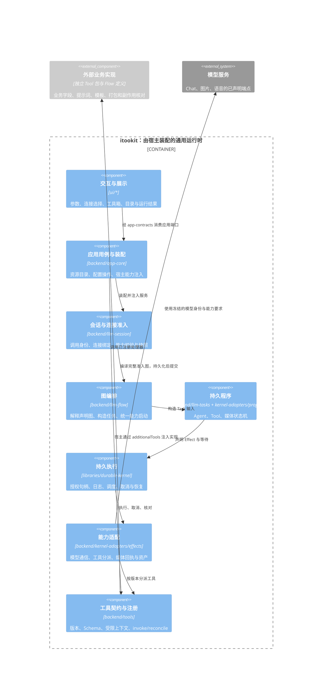

# 应用策略、机制与模块接口

## 模块归属

| 模块 | 拥有的职责 | 对外入口 |
| --- | --- | --- |
| app-core/configuration | 工具箱创建、定义交换、引用重映射、分组存储与目录；模型关联删除、Agent 工具授权 | ToolboxResources、ToolboxDrawers、ModelConfigurationCommands |
| app-core/projects | 项目目录与会话归属、组织查询和命令、项目归档 | ProjectService、ProjectSessions、ProjectTarget |
| llm-session/persistence | 关系事务、循环/项目边界检查、写租约守卫、删除意图 | ISessionRepository、SessionDeletionStore |
| app-shell/projects | 项目和同组列表、正文装配、业务目标与导航路径转换 | createProjectModule |
| app-shell/toolbox | 分类、抽屉展示、资源编辑器装配及模块生命周期 | createToolboxModule |
| app-shell/configuration | 删除影响展示与用户选择 | ConfigurationDeletionDialog |
| app-shell/browser | 文件编辑器连接、保存、媒体预览 | connectEditorLifecycle |
| vfs-ui | 列表/双列、选择、排序、异步动作执行 | BrowserSource、BrowserAction、VFSUIShell |

公共库与 immer 继续复用。按业务能力归组内部文件，不新增包或第二套资源渲染器。

## 外部业务扩展与通用机制

新增非通用业务通过独立工具包与 Flow 定义显式接入。以 [Anki 方案](anki-flow.md)为例，确定性补缺/覆盖规则、卡片模板、分组与打包代码、业务回执由 `tools/anki-cli` 业务包维护；提示词与编排只有一份应用资源声明源 `app-core/src/resources/flows/anki-generate.json`，通过产品目录提供安装和系统恢复。资源可以由应用携带，业务执行仍经外部 Tool 接入；核心不按业务名称分支。恢复后的 Flow 属于内部资源，可以由 Agent 引用。需要运行时，宿主按配置加载 Tool 工厂；用户已有定义、发布版本和手动分组保留。平台只提供同 Flow Task 资产读取、授权二进制文件 I/O 等通用端口，不解释卡片字段。

平台提供确定性 Tool 节点、注册/发现、版本与连接绑定、Schema、权限、取消、持久执行、恢复分派及通用资产/资源导入。Tool 同时可由 Flow 和 Agent 调用，不等同于模型自主选择的调用入口。核心通过契约分派到外部实现，不按具体工具名增加业务分支；HTTP 等宿主限制由外部清单声明，平台负责通用校验。

恢复调度属于平台，副作用的业务核对由工具实现。应补充通用生命周期扩展，不能为了绕过 Tool 恢复缺口将每个业务改成内置专用 Effect。外部工具包独立发布与按配置装配，不自动进入平台默认构建；应用产品目录可显式选择声明式 Flow 作为可恢复资源，恢复定义本身不加载工具包或执行模型请求。

## 当前改动的 C4 组件边界

以下是当前源码的模块关系，不表示每个 package 都是独立进程。Web、Tauri、CLI、HTTP 的宿主装配方式不同，执行机制共用。

工具实现由宿主注入；图中的处理器调用不构成核心对外部业务包的静态依赖。媒体 Effect 是通用模型通信能力，不能承载业务字段、制卡步骤或业务媒体选择策略。

### 2026-10-16 工作树审查

审查开始时已有 129 个受版本管理文件的改动，另有新增文件。文件数来自跨层契约传播和多项工作混合，不能据此认定每处修改都必要。

| 改动组 | 判断与处理 |
| --- | --- |
| Tool 节点、版本、结构化结果与 reconcile | 确定性调用的执行链；插件、Program、Effect、工具服务各有职责，保留 |
| 媒体节点、连接槽、快照与资产回执 | 通用模型能力；Agent 节点要求及同槽多节点要求也必须参加准入，已修正遗漏 |
| 内置业务入口移除 | 提示词、模板、工作区、宿主初始化和演示要同步移除，避免只隐藏 UI；现有用户文件保留 |
| Skill 投影迁至后端、工具箱导航读模型 | 修复前端拥有服务订阅/后端回读前端文件系统的边界问题，可独立交付；YAML 是显式允许的无平台 I/O 编解码依赖 |
| 目录快照、面包屑、独立库版本更新 | 导航优化，可与执行机制分开提交；不属于外部 Tool 接入的必要前置 |

本次只集中修补准入遗漏、架构检查和重复流程：能力启动判定统一放在 `llm-flow/flow/task-capabilities.ts`；纯计算/媒体节点不再无条件查询工具目录；历史测试改用中性的外部文件类型。没有新增扩展市场、业务队列或第二套 Runtime。

外部包安装/完整性锁定、宿主要求匹配、业务产物导出并未形成完整交付；`additionalTools` 是注入端口，不能宣称已经实现这些安装与部署能力。现有流程仍有兼容路径，本轮不以大规模重写掩盖这些缺口。

### 2026-10-22 Flow 产品资源与业务执行解耦

`app-core/presets/flow-library.ts` 返回新版作文 `essay-review` 与合并后的 `anki-generate`，启动播种和系统恢复共用该目录。作文源码和恢复文件名统一为 `essay-review`，保留新版隔离评审逻辑，不再安装 `essay-review-isolated`；存量文件及其发布版本保留，同名旧版文件不会被覆盖。Anki 的主流程与三个内联函数只维护在应用 JSON 中，工具包集成验收读取此唯一源。默认 Flow 抽屉为空；`ToolboxResources` 仍接受宿主注入的通用分组，也支持用户手动分组及归档往返。`FlowLibraryCommand.Restore` 接受显式传入的定义，按顺序发布新恢复的可调用版本；主定义通过通用 `functions` 数组携带内联函数，只安装主资源，不把局部函数独立安装到全局库。跨文件定义仍可按被调用方在前的顺序显式恢复。已有用户草稿与发布版本不被重复恢复覆盖。

通用恢复、依赖锁定和分组测试使用中性 Flow 夹具；产品目录测试另验证 Anki 在真实系统恢复页面可见、只恢复一个主文件及保留用户修改。普通 app-core 与 app-shell 测试不读取 Anki 子模块源码或加载 Rust 工具，业务执行集成验收由外部包显式运行。

### Agent 的 Flow 执行绑定

Agent 的 `execution.kind: flow` 引用内部注册 Flow 的 ID 和可选修订号，不依赖源码目录，也不要求 Flow 反向定义 Agent。宿主注入实际插件目录和资源观察端口，派生 `availability`；删除文件后禁用新调用，恢复并发布后重新核对，状态不写回 Agent 源文件。默认跟随最新发布，未发布编辑不影响已发布调用；参数表单每次读取所选修订的签名。Agent 归档携带所引用的发布 Flow 和跨文件依赖，内部局部函数身份保留。执行、队列冻结、提示词与恢复均复用通用 Flow/Kernel，详见[调用契约](flow-invocation-composition.md#agent-引用内部-flow)。

## 工具包贡献与用户连接

外部功能的连接字段和 Flow 归工具包维护。manifest.flows 声明包内资源，宿主验证已注册版本和内容指纹，通过 ToolPackages.installFlows 复用恢复与发布；应用内置目录不再承载新增厂商采集流程。ToolPackages.connections 暴露通用用户配置，秘密解析仅在宿主绑定的 ToolConnectionAccess 中提供。资源写入仍走已授权文件端口；完整 OAuth 与资源目标绑定的已实现/待实现边界见[外部功能扩展](function-extensions.md)。

## 配置写操作

运行时创建唯一 `runtime.configuration`，设置页面与工具箱共用它。

Provider 删除先调用 `inspectProviderDeletion(ids)` 得到受影响 Provider、Connection 和预览标识，再由原确认弹窗调用 `deleteProviders({ revision })`。当前用例不提供 Agent 保留、删除或替换选择；应用服务在写入前重读 Provider/Connection 依赖并验证预览，同一运行时的删除命令串行执行。

执行顺序为删除连接、删除服务商。底层配置存储不构成跨实体原子事务；部分失败抛出 `ConfigurationMutationError`，带有已完成步骤与原始错误。可以重新打开预览，根据当前数据继续操作。此实现不是持久化删除任务，也不宣称阻止绕过该入口的其他宿主并发写入。

UI 通过 `EditorHostContext.requestDelete(targets)` 请求确认和执行。列表直接调用相同确认界面，不打开或等待编辑器。IEditor 不包含删除能力。Modal 等待异步确认、防止重复确认并显示失败；失败时保持弹窗可见。

工具授权由 app-core 的 `saveToolGrant` 解释默认值并更新 Agent capabilityPolicy；UI 仅读取现状、选择 Agent 与提交启用状态。运行时访问检查仍由既有授权系统执行。

## 分组与展示

ToolboxDrawers 私有保存持久状态和资源目录。`setCatalog` 更新已发现的资源及默认分组；`snapshot/list/get/forPath` 生成可供调用方独立使用的查询结果。自定义归属、默认分组与未分组规则统一在服务中计算。

资源扫描在模块加载/刷新时完成，不依赖渲染。`resourceDrawers` 仅将查询快照与显示节点合并；切换筛选、搜索或重绘不会写入分组状态。重命名的同名校验与保存处于同一串行修改队列。源资源重命名仍通过事件更新归属。

模型按服务商关联分组、工具按用途/来源分组、自定义抽屉按用户归属分组；这些规则不合成一个通用目录 CRUD 接口。现有只读 VFS 投影保留，以兼容文件编辑器、归档和工作台适配；其创建与释放由工具箱模块负责，不由 bootstrap 分散管理。

## 项目与会话

ProjectService 不公开 repository 或目录挂载服务；通过 projects.sessions 提供 navigation、family、moveCandidates、rename、reparent、create、createChild、get。项目导航与同组菜单共用这些查询，不各自维护权威父子状态。查询用于界面，写入仍在 SessionRelations 事务内重验循环、项目归属、待删除状态与关系修订。

SessionDeletionStore 是必选契约，不能通过缺少 prepareSessionDeletion 或写守卫静默跳过删除恢复步骤。运行时恢复和 UI 删除仍调用同一 SessionLifecycleService。

项目归档输入输出使用 ProjectTarget：projectId、sessionId、项目内文件路径或组织分组路径。`folder:`、`@files` 与 URL 编码只在导航/VFS 适配边界解释；归档业务用例不接受这些显示路径。导入继续验证完整归档并补偿本次创建的资源，不改变会话物理存储布局。

## 装配与能力

WorkspaceController 只要求启动、打开、当前目标和销毁；创建由 WorkspaceCreation 单独声明。等待输入通过会话事件回调连接，不要求工具箱提供空实现。

createSettingsFactory 使用具名 SettingsFactoryOptions 注入服务、编辑器、文件连接器、删除交互与恢复操作。createToolboxModule 聚合工具箱目录、资源服务、编辑器工厂及释放顺序。Web/Tauri 使用相同模块；CLI 可直接调用无 DOM 的应用服务。

createProjectModule 聚合项目工作台、记忆管理交互与等待输入事件订阅。SessionWorkbench 使用具名 SessionWorkbenchOptions；有项目和兼容无项目模式都通过 ProjectSessions 创建会话，不在 UI 中直接调用 repository.createSession。

项目与工具箱返回相同 WorkspaceModule。它只暴露 WorkspaceHandle 与 dispose，不暴露具体工作台类。路由通过可选 restoreResource 能力恢复失效书签，普通 openResource 保留错误语义；bootstrap 不识别具体工作台类型。模块把事件订阅、目录投影和编辑器的生命周期放在一起，工作区动态移除与应用退出共享同一个释放 Promise，失败仍向调用方传播。

## 可执行的边界

`pnpm architecture:check` 检查 ui/backend/shared/libraries/apps 的生产源码静态依赖与 dependencies/peerDependencies，并运行检查器的边界用例；`pnpm test` 与 `pnpm test:matrix` 将它作为前置检查。

- app-core 只依赖明确列出的平台无关能力，不直接引入 Node 内建模块、DOM 或浏览器存储。
- 能力包不能反向依赖 app-core、app-shell 或 app-settings，包不能依赖 app 宿主。
- 跨包引用使用 package.json 声明的公开出口，禁止跨包相对路径与未公开子路径；类型引用、动态 import 和 re-export 同样检查。
- app-core 的公共出口使用具名导出，辅助算法与工具授权写入实现保留在模块内部。

app-settings 仍属于应用功能包；apps/demo 是使用部分历史 API 的 Vite 演示宿主，按宿主检查，其他包不能依赖它。测试夹具不受生产源码检查约束。检查器是静态边界守卫，不能代替业务职责审查，也不分析运行时拼接的模块名或任意反射访问。

## 原生用量与费用

原生适配器拥有计量协议的解释、恢复与去重；价格和供应商默认价不进入 cells 或 cells-driver。定价解析和算术位于 kernel-adapters 的纯 contracts 入口，模型目录与默认金额只通过产品 presets 或用户配置提供。app-core 在装配时注入估算器，按会话 revision 缓存估算并随定价快照失效；没有估算器时仍可浏览和操作会话。

远程原生历史估算与本地已入账调用是不同来源：展示携带 transcript 范围和估算标识，不把含继承历史的分支估算累计进费用账本。前端不选择价格、不猜模型归属，也不依赖原生协议或日志文件。

Flow 库恢复时是否发布修订属于应用策略，由 app-core/presets/restore-flows.ts 显式协调；核心 DraftRestore 保持只恢复草稿。图片上传限制由字段声明，Agent 使用标准多模态消息内容契约，声明模板与历史快照分开处理。

## 可插拔协作看板

`@nestos/app-core/kanban` 是显式装配的可选应用服务；纯契约由 app-contracts 拥有，用户 VFS 的事务存储由宿主注入。项目与系统看板维护唯一工作项，全局视图只聚合；相关 Session、职责、估算、转交和超时升级均不进入 durable-kernel。模型唤醒、工具入口和持久邮箱桥由宿主或外部适配负责，看板 AI 协作默认关闭，用户显式绑定已发布的规划/执行 Agent 或 Flow 并启用后才启动依赖分析与自动执行。默认应用宿主装配个人看板、共享 UI、系统通知及持久调用接线，项目存储与来源扫描仍显式绑定。详见 [Kanban 协调模块](kanban-coordination.md)。

## app-core 的协调边界与存量审查（2026-11-11）

目标是由 app-core 组合领域服务、传递授权上下文并协调跨模块调用。模块的领域规则与执行机制由各自所有者提供端口，不能为减小 app-core 而把 Git、看板或项目业务集中到 Kernel。本次先完成执行事实与 Git 领域的纵向拆分；其余存量目录不能作为继续增加业务实现的依据。

| 职责 | 应拥有的模块 | 当前事实与迁移边界 |
| --- | --- | --- |
| 执行准入、调度、Effect、取消、恢复、unknown 和排空 | durable-kernel；kernel-adapters 提供受限副作用适配 | LLM/Flow 已经由 Session/独立调用进入 Kernel。外层可保存业务意图与批准，不另建执行队列，不根据聊天或 HTTP 成功猜测执行终态 |
| 会话轮次、输入与执行绑定 | llm-session；远程原生队列由 Cells 驱动端拥有 | app-core/run 的 Session/Kernel 事实解析应收敛为下层提供的执行观察契约，适配层只映射业务结果 |
| 管理任务、执行任务、依赖、验收和资源归属关系 | kanban | 优先复用 itemsWithinRoots 等公开规则。日志引用不赋予归属；业务 scan 失败与运行时是否排空分别核对 |
| Git 工作区、合并、版本校验、制品和清理规则 | 独立 Git 交付 Tool/领域包；Flow 声明业务步骤 | Git 命令、版本、来源、合并核验、资源归档与清理回执已归 backend/git-delivery。app-core/presets 的剩余实现承担项目授权、任务/Session 事实读取和端口组合；不执行原始 Git 指令或解析执行终态 |
| httpd/VM 等基础设施生命周期 | 宿主与进程外监督器 | 进程外控制负责被重启进程停止后的接续。业务通过受限端口请求和核验回执；普通进程驱动不拥有第二套业务调度与恢复机制 |
| 界面状态、入口与操作反馈 | 领域读模型与对应 UI | UI 消费归属、准入和结果，不推断业务成功、不因读取创建执行或调用 Git |

业务事实、授权事实、执行事实和资源事实分别保留权威来源。Task 完成、Session 某轮失败、Git 已合入、验收通过和资源可清理并非同一状态；经读模型组合展示，不串成一个跨层总状态机。跨模块统一使用稳定操作身份、冻结输入、执行句柄、结构化回执及副作用核验。

迁移采用可验证的纵向切片：先明确事实所有者与公开端口，再迁移实现及失败/恢复测试，最后由 app-core 注入端口。先完成 Git 交付领域与执行桥的接口划分，再迁出其策略和副作用；每批删除旧实现，避免同时维护新旧执行路径。Kernel 不导入业务包，独立 Kanban 不导入 Kernel/Session SDK，业务工具经现有 Tool/Effect 机制接入。

### 已实施的职责收敛

- `durable-kernel.taskExecutionStat` 统一提供执行树是否收尾、是否有不确定 Effect 的只读事实；跨 Session 的任务不混入同一执行。
- `llm-session.createSessionSubmission/createPublishedOperation/createSubmissionControl` 拥有轮次/独立调用与 Kernel 回执的对应及终态解析；同一 Kernel 快照核对执行身份，本次迁移的交付提交链在 app-core 不再解析 Round/Task.exit。旧的 app-core 实现已删除。
- `kanban.managementTaskOwner/itemsWithinRoots` 拥有管理任务归属和子树规则，应用只消费其结果。
- `cells-driver.harnessExecutionConstraints` 拥有原生 writer、观察、草稿、队列与控制回执的约束；应用不重复推导原生 busy/unknown 状态。
- `git-delivery` 独立模块拥有 GitSource/GitIntegration/GitCleanup 的规则与实现。上下文查询接受当前业务事实端口，清理接受授权、读取资源与执行屏障端口，没有对 app-core 的反向依赖。资源日志继续使用旧 key、schema 和操作身份，不迁移或重放在途执行。

统一执行仍是 Session/Flow → Kernel → 已授权适配器。Git 领域的资源意图不调度 Task，不重派 unknown，Kernel 内不加入 Git/看板字段。httpd 启停监督器留在进程外；服务切换只有受信宿主端口可调用。

Cells 的工作区互斥与原生输入交接属于节点执行机制。原生执行模式无法仅凭 readOnly 声明证明进程不可写，因此保留必要互斥；短命令收尾通过文件门的有界等待交接，原生输入只发送一次。宿主不复制重试循环或释放条件。追踪跨异步/队列恢复使用经过校验的 trace/span，上层稳定操作身份与节点原生回执继续分别保留。

### 看板结果恢复的职责收敛

| 事实或动作 | 所属模块 | 宿主接入 |
|---|---|---|
| 候选索引、任务/最新派发复核、暂停取消与恢复推进 | `@nestos/kanban` integration 的 task-result-recovery | app-core 只提供授权及证据端口 |
| 原 Effect 结果未知、只核对不授权重放 | `@nestos/durable-kernel` 的 reconcile resolution | Harness 适配器读取原执行回执 |
| 原生 Session/turn、节点 epoch、持久 namespace 与正式终态 | projects 的 Harness 适配层 | 当前项目授权、原身份历史读取 |
| 后续原生轮次发布的完成结果 | Cells publication origin + completed-result 业务适配 | 核对 session/turn/operation 与结果摘要，不从聊天文本推断 |
| 源码与工作树交付证据 | Git 交付端口 | completed-result 复用既有 verifyDelivery |

app-core 的 task-recovery-results 不再遍历任务或决定状态推进，只将宿主的 frozen decision 自动授权、恢复证据和既有 recoverTask 接入看板模块。结果候选与待处理索引同事务维护；结束候选保留历史但退出后续扫描。Session continuation 适配仍在 app-core，因为它消费真实 Session/Kernel 契约，独立看板不引入这些依赖。

### Kanban 操作插件与执行观察

看板操作通过 `operationPlugins` 注册，软件开发规则及操作服务归独立 `@nestos/kanban-development`。kanban 只保存插件路由、版本绑定及通用协调事实；其他插件可定义自己的动作。Session 统一观察调用与执行树、核对不确定 effect；app-core/kanban 通过观察端口消费事实，不直接依赖 Kernel。具体契约和兼容边界见 [操作插件](kanban-operation-plugins.md)。
