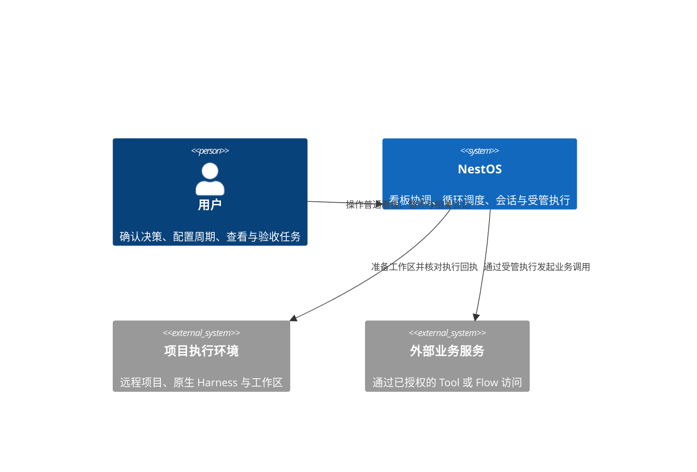
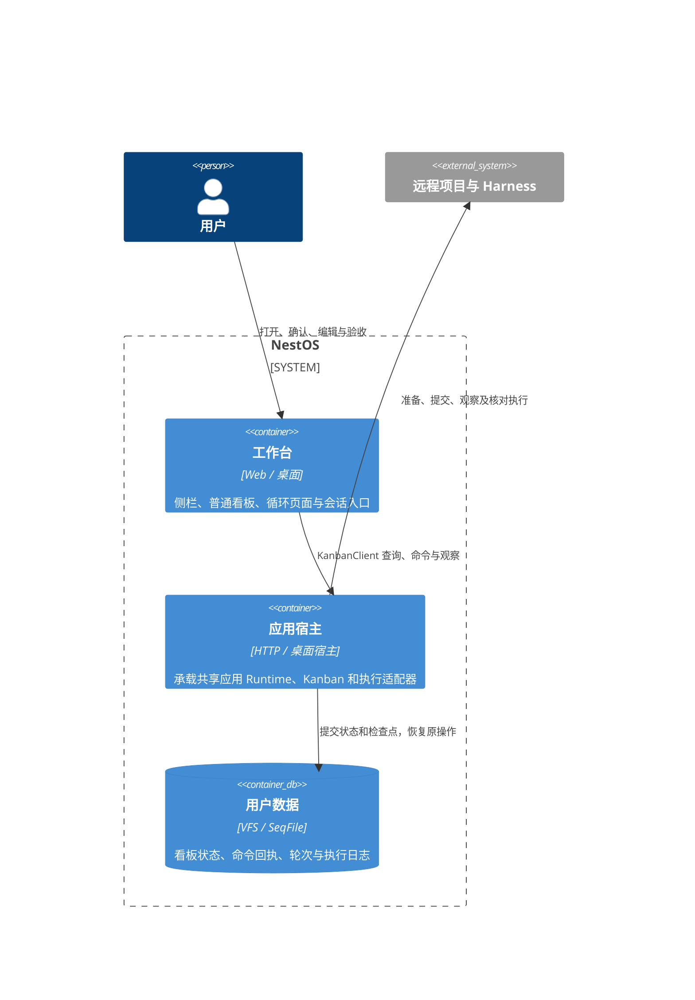
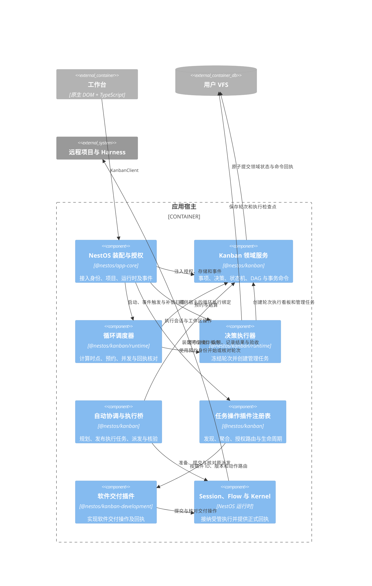
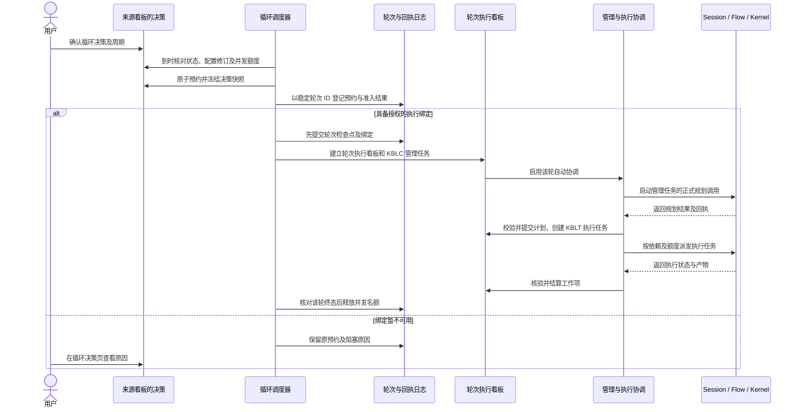
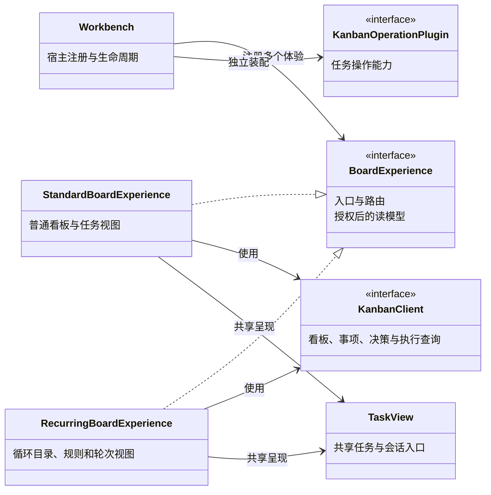

# Kanban 架构与插件边界

本文记录 NestOS 当前的 Kanban 架构，以及将「普通看板」和「循环」作为产品能力按需装配时的设计。图采用 Mermaid C4 和 UML 时序图。

## 当前实现

**Kanban 支持同一运行时装配多个任务操作插件。普通看板是核心能力，循环是内建的决策调度与视图能力。** 当前没有可安装、卸载或按类型选择的看板插件注册表。

| 能力 | 职责 | 当前装配方式 |
| --- | --- | --- |
| 普通看板 | 工作项、管理与执行任务、依赖、在制额度、授权、验收和归档 | `@nestos/kanban` 领域核心和 `@nestos/kanban-ui` 普通看板视图 |
| 循环 | 保存调度规则、预约轮次、跟踪该轮的管理与执行任务 | 核心中的循环调度器和 UI 中独立的「循环」入口 |
| 任务操作插件 | 在适用的任务上提供交付、核验等操作和回执 | 宿主在运行时装配多个 `KanbanOperationPlugin` |
| 决策模块 | 为决策附加带版本的业务策略，例如软件交付审批 | 宿主注册规则，决策引用选定的模块版本 |
| 会话请求插件 | 向已绑定的会话开放获授权的方法 | 应用层以 `discover`、`describe`、`invoke` 路由，按会话范围授权 |
| Tool 和 Flow | 实现业务规则、模型执行和外部副作用 | 宿主发布并绑定版本，Kanban 通过正式执行端口调用 |

### C4 系统上下文

### C4 容器

### C4 应用宿主组件

### 软件模块的边界

Kanban 核心通过宿主端口请求准备、规划和执行，轮次持久化所选的准备描述符。NestOS 在装配层把普通循环的 `project-directory` 绑定到独立目录适配器，把选择了软件模块的循环的 `git-worktree` 绑定到软件适配器。两者共用原生会话通道、固定发布目标和结果回执。

项目目录适配器只准备专用目录及任务输入。软件适配器额外提供 Git 基线与工作树、交付拆解校验、合并、构建和发布。普通循环的结果通过正式会话回执核对，无需软件交付检查。

### 实现入口

| 层 | 源码 |
| --- | --- |
| 公共接口、状态与编号 | [contracts](../../libraries/kanban/src/contracts/index.ts)、[module.ts](../../libraries/kanban/src/module.ts)、[numbering.ts](../../libraries/kanban/src/numbering.ts) |
| 本地与远程条件事务存储 | [store.ts](../../libraries/kanban/src/store.ts)、[conditional-store.ts](../../libraries/kanban/src/conditional-store.ts) |
| 生命周期及扩展装配 | [runtime.ts](../../libraries/kanban/src/runtime/runtime.ts)、[runtime-ports.ts](../../libraries/kanban/src/runtime/runtime-ports.ts) |
| 循环与管理任务 | [recurrence-scheduler.ts](../../libraries/kanban/src/runtime/recurrence-scheduler.ts)、[record-execution.ts](../../libraries/kanban/src/runtime/record-execution.ts) |
| 自动协调与任务操作插件 | [automation.ts](../../libraries/kanban/src/runtime/automation.ts)、[operation-plugins.ts](../../libraries/kanban/src/runtime/operation-plugins.ts) |
| NestOS 接线、循环执行绑定和决策模块 | [personal.ts](../../backend/app-core/src/kanban/personal.ts)、[recurring-automation.ts](../../backend/app-core/src/kanban/recurring-automation.ts)、[kanban-project-directory.ts](../../backend/app-core/src/presets/kanban-project-directory.ts)、[decision-modules.ts](../../backend/app-core/src/kanban/decision-modules.ts) |
| 侧栏和循环界面 | [sidebar.ts](../../ui/app-shell/src/kanban/sidebar.ts)、[loop-catalog.ts](../../libraries/kanban-ui/src/loop-catalog.ts)、[loop-board.ts](../../libraries/kanban-ui/src/loop-board.ts) |

## 循环如何复用普通看板能力

「循环」在侧栏与普通看板平级。循环目录读取各可访问来源看板的循环决策。来源看板保存决策、周期和业务上下文，每次新准入的轮次使用自己的执行看板。循环页通过原决策及轮次身份定位管理任务和下级执行任务。

用户确认循环决策后，调度器自动检查已到时点。宿主在轮次执行看板中应用有效的已发布规划和执行绑定。选择了软件模块的循环可复用有效的 Git 工作树绑定。普通循环使用已发布的文件协议规划与执行目标，在主项目下创建该次执行的专用目录，并通过 Session 报告结果。所属普通看板的整板「AI 协作」开关无需启用。「决策」页显示只读的主项目目录链接，历史和任务从「轮次历史」进入。循环决策与任务以「项目:ID 名称」展示项目。循环目录的项目和状态筛选支持全选、取消全选及应用。宿主缺少有效目标时保留原预约，并在循环决策页显示原因。

普通看板和循环共用管理任务、依赖、派发、会话、结果核验及操作插件。旧轮次继续使用原执行看板和身份。调度预约先于执行副作用，重启时复查原检查点。普通任务保持 `KBC-`、`KBT-`，循环任务使用 `KBLC-`、`KBLT-`。这些前缀用于可见编号和查找，轮次与任务内部 ID 继续作为深链和幂等身份。

## 是否拆成看板类型插件

可以把两者设计成独立装配的**看板体验**。适合的依赖是普通看板体验和循环体验分别依赖共享的 Kanban 领域能力。循环复用普通任务链和公共任务视图，从而可以独立显示在侧栏，普通入口也可以单独配置。

上图描述可演进的接口边界，`BoardExperience` 和两个实现是设计角色。当前 UI 由内建路由装配，循环调度由宿主运行时装配。

| 边界 | 演进约束 |
| --- | --- |
| 体验与后台生命周期 | 体验负责入口、路由和读模型。调度器由宿主持续运行，关闭循环页面不影响已授权的轮次。 |
| 数据与权限 | 公共核心拥有任务状态机、稳定编号、存储和执行授权。循环拥有规则、时点和轮次关联。执行目标作用于轮次，来源只提供决策与项目范围。 |
| 多插件并存 | 普通与循环是用户体验扩展。任务操作、决策模块和会话请求各沿用自身注册及授权契约，可以作用于两个体验。 |
| 兼容性 | 保留现有来源看板、决策、轮次、任务及会话的深链。变更装配方式时通过原检查点恢复，历史执行的绑定继续按冻结版本核对。 |

如果未来出现第三种需要独立路由或读模型的看板体验，可以先抽取宿主入口与路由契约，再迁移普通和循环入口。持久轮次、调度、任务状态机以及执行桥继续使用当前公共机制。

相关设计见 [通用 Kanban 协调模型](./kanban-coordination.md)、[Kanban 任务执行](./kanban-task-execution.md) 和 [决策与会话协作](./kanban-session-coordination.md)。
