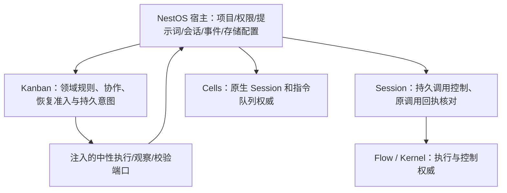

# Kanban 宿主边界审计与改进方案

审计日期：2026-11-09。口径为当前工作树 `backend/app-core/src/kanban/*.ts` 的生产源码，不含测试、presets、独立库及未跟踪文件以外的历史版本。实施前基线为 **67 个文件、2915 行**，本轮实施后为 **68 个文件、2811 行**；2,545 行是其他快照的统计，不能直接作为此次基线。

## 结论与审计范围

抽查判断基本成立：仍有通用规则和持久调用控制混在宿主。按“换成其他宿主后是否仍成立”分拆函数和契约，不能把整个目录搬进 `@nestos/kanban`，也不能把所有恢复都归 Kanban。此次覆盖全部文件的入口、依赖与职责归属，并重点核对控制、协调结果、提案、恢复和交付链路；静态职责审计不等于所有崩溃窗口和线上行为已经验收。

`@nestos/kanban` 已有 `createTaskCoordinator`、`coordinateOperation`、`analyzeItem`、`KanbanCollaboration`、记录执行/控制、指令回复和执行桥等机制。应扩展这些入口，避免另建一套同职责状态机。`backend/llm-session/src/session/independent-call-controls.ts` 已负责调用成员授权及 Flow/Kernel 控制路由；原先缺少业务无关的**持久控制编排入口**；本轮补齐该入口，复用既有底层控制权威。

## 实施结果

| 层 | 已落地入口 | 宿主剩余职责 |
| --- | --- | --- |
| Session | `controlIndependentCall` / `independentCallSettled`，最小原子 journal 与控制端口；请求 action/目标校验、冻结路由、claim、原回执查询及双终结判断 | `call-lifecycle.ts` 仅适配旧 key、原错误码和直接 submission fallback；不再实现控制状态机。 |
| Kanban 纯规则 | `validateCoordinationResult`、`compileCoordinationProposal`、`itemWithinRoots` / `itemsWithinRoots` | 注入动作白名单、稳定 ID 与获授权引用继承；Native channel 解码、提示词、通知留宿主。 |
| Kanban 协作提交 | journal `updateMany` + `commitCollaboration`，同事务冻结领域命令、分解检查点、修复意图及 outbox；阶段 prepared/committed/delivered | 通道 ACK、事件投影仍由宿主以原身份交付；ACK 未确认保留 committed，重试不重新发布子项。 |
| Kanban 决策用例 | `confirmRecordExecution` / `advanceRecordCancellation`，确认后冻结执行请求、核对取消状态 | 真实用户确认、当前项目授权、channel 请求/响应与会话视图投影。 |
| Kanban 恢复 | `resumeCollaborationRepairs`、`taskRecoveryEligibility`、`activeRecoveryIssueIds`、`findRetainedExecution`、`validateDecisionSource` | 读取当前部署版本、原生 Session/工作树等事实，并提供正向证据。跨项目或执行代次的前驱不能被接管。 |
| Kanban 资源占用 | `reserveJournalResource` / `releaseJournalResource`，原子争抢、原作用域核对、正向释放证据 | 业务目标选择、旧 ReviewJob 是否真实结算；新占用记录只保存绑定，不复制整个开发流程状态。 |
| NestOS 开发业务 | `item-operation-results.ts` 独立承接结果 schema、版本及合并校验；操作协调继续复用库 `coordinateOperation` | build/deploy/accept/merge/cleanup 顺序及实际副作用始终归宿主，不迁入核心。 |

兼容旧 `call-lifecycle:` / legacy control key、`fix-create:`、`coordination-confirm:`、decomposition 和 repair-resumption 记录。旧提交标记不回退 prepared；query-only 的旧暂停/恢复记录可确定性恢复命令路由；没有足够证据的路由拒绝恢复。`resume→withdraw` 是同一逻辑恢复动作，不能误判为新暂停。

领域事务与外部 ACK 不宣称跨系统原子性：外部交付可能重试，始终复用原 operationId/提案身份；宿主 ACK/通知端口必须按该身份幂等。同一命令 key 的不同内容在批量准备事务内拒绝，检查点和意图一起回滚。运行中任务未迁移身份，未修改宿主路径或引入新的共享库。

## 实施前确认的问题与处理原则

| 位置 | 当前职责混合 | 完整改进 |
| --- | --- | --- |
| `call-lifecycle.ts` | 冻结 Session/call/task/epoch，首次写入与原请求回执查询，撤回未确认暂停、取消剩余树、判断 caller/tree 都终结；同时引用 Kanban journal 和应用 submission fallback | Session 层提供持久调用控制服务，注入最小 journal、调用目录、命令及日志端口。宿主仅选调用身份、适配原 journal 和处理 direct submission fallback；既有控制命令继续由 Session/Flow/Kernel 执行。 |
| `task-coordinator.ts` | 回调内验证 `kanban.coordination/1`、summary、suggestions 数量/子项范围/理由长度，同时读取原 Session、channel、work context、通知 | 形状与作用域校验归 Kanban；允许的动作集合由宿主注入。原生状态/错误码转换为中性观察与失败分类，Session channel、提示词、通知继续留宿主。 |
| `coordination-proposal.ts` | 纯子项/依赖/修复对象规则与 `nestos-remote-project` / `nestos-decision-run` 引用过滤混合 | 提案解析、局部 key→稳定 ID、层级与依赖/修复校验归 Kanban；ID 工厂及引用继承策略通过端口注入。最终仍经过 reducer 授权与一致性校验。 |
| `task-fix-acceptance.ts` / `coordination-conversation-requests.ts` | 在宿主登记 decomposition-estimate/status 和 repair-resumption，再调用库协作/计划命令 | 把领域检查点及修复续办意图纳入库已有协作用例；持久 outbox 记录通道 ACK/通知待办。领域提交和 ACK 分开核对，重复确认不会再次建立子项。 |
| `decision-conversation-requests.ts` / `coordination-conversation-requests.ts` | 原生请求解析与记录确认、派生执行、后代范围遍历、规划重试混合；`related`/`relatedTasks` 重复表达后代关系 | 后代范围查询与确认→记录/执行的领域用例归库。宿主先核对真实用户证据和项目授权，再调用库用例，最后转换 channel 回执。 |
| `item-operation-jobs.ts` | 已复用库 `coordinateOperation`，但冻结业务请求、部署替换核对、结果 schema、merge plan 同文件 | 继续使用原操作协调器。业务 schema/版本/合并校验保留宿主；提取小型验证/观察适配器，防止为了“通用”把部署字段放进核心。 |
| `automatic-delivery.ts` / `automatic-delivery-target.ts` | 无关业务的步骤检查点、稳定请求和占用释放，与固定开发动作及 ReviewJob 存储结构耦合 | 优先薄化业务步骤适配。确需复用时提取参数化步骤/占用机制，输入中性步骤和终结证据；禁止核心默认 build/deploy 流程。 |
| `task-recovery*.ts` / `restart-barrier.ts` | 幂等恢复意图、工作项依赖/阻塞与真实部署版本、原生执行、工作树占用耦合 | 核心接收版本化的中性恢复证据，决定领域准入；宿主负责获取和复验真实证据、当前权限与原 Session。unknown 不得推定空闲或成功。 |
| `host-policy.ts` | 应用路径及 artifact scheme | 保持宿主。库仅接受 directory/artifactScheme 配置，不导入 NestOS 路径。 |

额外需补回归的身份约束：`call-lifecycle.ts` 恢复冻结记录时校验了 Session/call/execution/task，但没有校验本次 action 与冻结请求的逻辑 action。一旦相同 requestId 被用于 pause 后的 resume/cancel，可能沿旧路由查询，却按本次 action 投影状态。应持久化规范化的原始请求指纹并在首次 claim 前拒绝不一致；历史记录需识别 `resume→withdraw` 的等价路由，不能简单比较底层命令字符串。已通过隔离的 journal/call 端口夹具复现：先 pause 再以相同 requestId 调用 resume，第二次实际查询的仍是 pause 回执，但函数返回 resumed。未对线上 Session 执行控制；真实 Session 层回执校验及宿主调用方是否允许该输入还需集成核对。此缺口已由 Session 的 `controlIndependentCall` 修复，并由 Session 回归及宿主真实 SeqFile journal 回归验证；相同 requestId 的不同动作在控制命令前拒绝，返回身份冲突。

## 实施前的全目录职责清单

下面按职责分组逐一覆盖实施前的全部生产文件，行数保留原审计快照；新增宿主验证文件和下沉后的入口见实施结果。“混合”表示按函数拆分，并不代表该组整体迁移。

### 装配、授权、存储与事件（保留宿主）

运行时装配、主体权限、发布目录、应用目录与事件投影；validation 仅为宿主错误适配，不值得为了减少行数新增公开 API。

| 文件 | 行数 |
| --- | ---: |
| [`module.ts`](../../backend/app-core/src/kanban/module.ts) | 25 |
| [`personal.ts`](../../backend/app-core/src/kanban/personal.ts) | 133 |
| [`personal-automation.ts`](../../backend/app-core/src/kanban/personal-automation.ts) | 106 |
| [`store.ts`](../../backend/app-core/src/kanban/store.ts) | 5 |
| [`index.ts`](../../backend/app-core/src/kanban/index.ts) | 12 |
| [`host-policy.ts`](../../backend/app-core/src/kanban/host-policy.ts) | 2 |
| [`automation-authority.ts`](../../backend/app-core/src/kanban/automation-authority.ts) | 25 |
| [`automation-targets.ts`](../../backend/kanban-development/src/automation-targets.ts) | 20 |
| [`notifications.ts`](../../backend/app-core/src/kanban/notifications.ts) | 58 |
| [`health-events.ts`](../../backend/app-core/src/kanban/health-events.ts) | 19 |
| [`work-log-policy.ts`](../../backend/app-core/src/kanban/work-log-policy.ts) | 15 |
| [`flow.ts`](../../backend/app-core/src/kanban/flow.ts) | 15 |
| [`validation.ts`](../../backend/app-core/src/kanban/validation.ts) | 5 |

### 来源、资源与会话投影（保留宿主）

读取 NestOS Session/Kernel/Cells、当前项目与授权；输出库定义的中性 DTO。跨查询缓存和权限失效仍由宿主管理。

| 文件 | 行数 |
| --- | ---: |
| [`local-source.ts`](../../backend/app-core/src/kanban/local-source.ts) | 34 |
| [`harness-source.ts`](../../backend/app-core/src/kanban/harness-source.ts) | 55 |
| [`session-source.ts`](../../backend/app-core/src/kanban/session-source.ts) | 32 |
| [`native-session-activity.ts`](../../backend/app-core/src/kanban/native-session-activity.ts) | 37 |
| [`related-session-executions.ts`](../../backend/app-core/src/session/execution-facts.ts) | 65 |
| [`related-sessions.ts`](../../backend/app-core/src/kanban/related-sessions.ts) | 71 |
| [`session-resource.ts`](../../backend/app-core/src/kanban/session-resource.ts) | 37 |
| [`resource-catalog.ts`](../../backend/app-core/src/kanban/resource-catalog.ts) | 19 |
| [`task-projects.ts`](../../backend/app-core/src/kanban/task-projects.ts) | 48 |
| [`resource-operation-index.ts`](../../libraries/kanban/src/runtime/resource-operation-index.ts) | 18 |
| [`planning-sessions.ts`](../../backend/app-core/src/kanban/planning-sessions.ts) | 22 |
| [`decision-project-scope.ts`](../../backend/app-core/src/kanban/decision-project-scope.ts) | 21 |

### 执行与控制（混合：Session 机制 + 宿主适配）

控制路由冻结、提交/回执核对、调用树收敛适合 Session 层；Kanban 执行 DTO、发布目标、提示词、调用来源与原生上下文转换留宿主。

| 文件 | 行数 |
| --- | ---: |
| [`call-lifecycle.ts`](../../backend/app-core/src/kanban/call-lifecycle.ts) | 59 |
| [`control-adapter.ts`](../../backend/app-core/src/kanban/control-adapter.ts) | 46 |
| [`published-executor.ts`](../../backend/app-core/src/kanban/published-executor.ts) | 80 |
| [`published-work.ts`](../../backend/app-core/src/kanban/published-work.ts) | 79 |
| [`continued-work.ts`](../../backend/app-core/src/kanban/continued-work.ts) | 40 |
| [`session-operation.ts`](../../backend/app-core/src/projects/original-execution-session.ts) | 29 |

### 规划与上下文（混合：Kanban 规则 + 宿主适配）

库已承担分析与协调状态机；剩余候选是结果形状/子项范围、层级与修复依赖规则、重启阻塞投影。业务动作、重试配置文件、项目引用及运行状态读取留宿主。

| 文件 | 行数 |
| --- | ---: |
| [`analysis-adapter.ts`](../../backend/app-core/src/kanban/analysis-adapter.ts) | 70 |
| [`analysis-recovery.ts`](../../backend/app-core/src/kanban/analysis-recovery.ts) | 28 |
| [`work-context.ts`](../../backend/app-core/src/kanban/work-context.ts) | 13 |
| [`coordination-proposal.ts`](../../backend/app-core/src/kanban/coordination-proposal.ts) | 32 |
| [`task-coordinator.ts`](../../backend/app-core/src/kanban/task-coordinator.ts) | 63 |
| [`restart-barrier.ts`](../../backend/app-core/src/kanban/restart-barrier.ts) | 15 |

### 决策与管理会话（混合：Kanban 用例 + 原生通道适配）

会话目录、harness 选择、用户消息证据与 channel 协议留宿主；确认后执行/取消、后代工作项范围与提案确认可在库已有 record-conversation/record-control 用例上收口。

| 文件 | 行数 |
| --- | ---: |
| [`conversation-policy.ts`](../../backend/app-core/src/kanban/conversation-policy.ts) | 13 |
| [`decision-conversation-ports.ts`](../../backend/app-core/src/kanban/decision-conversation-ports.ts) | 13 |
| [`decision-conversations.ts`](../../backend/app-core/src/kanban/decision-conversations.ts) | 45 |
| [`decision-conversation-transport.ts`](../../backend/app-core/src/kanban/decision-conversation-transport.ts) | 82 |
| [`decision-conversation-views.ts`](../../backend/app-core/src/kanban/decision-conversation-views.ts) | 33 |
| [`decision-conversation-requests.ts`](../../backend/app-core/src/kanban/decision-conversation-requests.ts) | 119 |
| [`decision-conversation-confirmation.ts`](../../backend/app-core/src/kanban/decision-conversation-confirmation.ts) | 13 |
| [`decision-conversation-cancellation.ts`](../../backend/app-core/src/kanban/decision-conversation-cancellation.ts) | 69 |
| [`coordination-conversation-requests.ts`](../../backend/app-core/src/kanban/coordination-conversation-requests.ts) | 61 |
| [`record-coordination.ts`](../../backend/app-core/src/kanban/record-coordination.ts) | 23 |

### 修复、回复与恢复（混合：Kanban 协作 + 宿主证据）

KanbanCollaboration、taskReplies 等已在库。剩余分解状态登记/修复后续办应纳入库同一协作事务；真实版本、工作树、原会话、通道回复、用户显式版本批准仍归宿主。

| 文件 | 行数 |
| --- | ---: |
| [`task-fix.ts`](../../backend/app-core/src/kanban/task-fix.ts) | 60 |
| [`task-fix-contracts.ts`](../../backend/app-core/src/kanban/task-fix-contracts.ts) | 7 |
| [`task-fix-preparation.ts`](../../backend/app-core/src/kanban/task-fix-preparation.ts) | 32 |
| [`task-fix-confirmation.ts`](../../backend/app-core/src/kanban/task-fix-confirmation.ts) | 26 |
| [`task-fix-acceptance.ts`](../../backend/app-core/src/kanban/task-fix-acceptance.ts) | 32 |
| [`task-fix-channel.ts`](../../backend/app-core/src/kanban/task-fix-channel.ts) | 17 |
| [`task-fix-messages.ts`](../../backend/app-core/src/kanban/task-fix-messages.ts) | 17 |
| [`task-communication.ts`](../../backend/app-core/src/kanban/task-communication.ts) | 37 |
| [`task-replies.ts`](../../backend/app-core/src/kanban/task-replies.ts) | 25 |
| [`task-recovery.ts`](../../backend/app-core/src/kanban/task-recovery.ts) | 62 |
| [`task-recovery-ports.ts`](../../backend/app-core/src/kanban/task-recovery-ports.ts) | 15 |
| [`task-recovery-channel.ts`](../../backend/app-core/src/kanban/task-recovery-channel.ts) | 63 |
| [`task-recovery-state.ts`](../../backend/app-core/src/kanban/task-recovery-state.ts) | 41 |
| [`recovery-workspace.ts`](../../backend/app-core/src/kanban/recovery-workspace.ts) | 16 |

### 开发交付（宿主策略 + 已有库操作协调器）

build/deploy/accept/merge/cleanup 顺序、版本证据、合并计划、部署替换核验是开发业务；coordinateOperation 已在库。只抽象无业务动作的持久步骤推进/资源占用机制，不整体迁移这些文件。

| 文件 | 行数 |
| --- | ---: |
| [`item-operations.ts`](../../backend/kanban-development/src/item-operations.ts) | 217 |
| [`item-operation-types.ts`](../../backend/kanban-development/src/item-operation-types.ts) | 51 |
| [`item-operation-jobs.ts`](../../backend/kanban-development/src/item-operation-jobs.ts) | 118 |
| [`item-operation-log.ts`](../../backend/kanban-development/src/item-operation-log.ts) | 15 |
| [`automatic-delivery.ts`](../../libraries/kanban/src/runtime/automatic-delivery.ts) | 111 |
| [`automatic-delivery-target.ts`](../../libraries/kanban/src/runtime/automatic-delivery-target.ts) | 29 |

## 目标边界

Kanban 不导入 Session、Cells、Kernel、应用包、业务提示词或部署字段。Session 不依赖 Kanban journal 类型；使用最小结构端口。Cells 的原生恢复与 Kanban 工作项恢复不是同一状态机，不能共享一份可写状态。NestOS 负责授权和绑定，不能以视图生命周期替代 Session 生命周期。

## 已实现的最小契约

| 所属层 | 入口与数据 | 保证 |
| --- | --- | --- |
| Session | 持久控制请求 `{requestId, sessionId, callId, action}`；注入中性 `get/update/claim` journal、调用目录、控制端口与诊断 | 冻结包含逻辑 action 的请求指纹与精确 execution/task/epoch 路由；同 ID 不同请求拒绝；submitting 后仅查询原回执；外部效果仍由既有控制命令执行。 |
| Kanban | 协调结果验证：`output + snapshot.children + allowedActions` | 统一限制长度、数量、目标范围和动作；不知道 channel、profile 或业务动作名称。 |
| Kanban | 协调提案编译：`proposal + board/item snapshot + idForKey + inheritReferences` | 局部 key 稳定映射、依赖/修复目标有界、继承策略可注入；返回现有 Definition/Plan，最终由 reducer 再校验。 |
| 宿主 | Native/Kernel/部署观察 → 中性状态、失败分类与领域恢复证据 | 核对真实源权限、操作身份、版本与新鲜度；执行 succeeded 不替代业务产物验证；UI 视图关闭不改变真实执行结论。 |

这些是对现有服务补充的职责契约，不要求另建一个“大通用库”。先在既有 Kanban/Session 包归位；两个宿主通过端口复用相同机制。一次操作仅有一个持久意图写者，避免新旧协调器同时提交副作用。

## 实施步骤与验收要求

1. **先固定契约及身份约束。** 补 action/idempotency、unknown 不重发、caller/tree 双终结、prepared 后崩溃、提交后丢回执、旧 epoch、权限变化及关停排空测试。明确真实执行完成与业务结果验证完成的区别；日志统一 operationId/stage/result/code/durationMs，不记录正文。
2. **下沉 Session 控制编排。** 使用既有独立调用控制服务，不再创建平行命令。宿主将旧 `call-lifecycle:` 和 legacy key 适配到新服务；保留旧操作 ID、指纹与 submitting 状态。迁移期间只有一个写者，未知结果只能查询原回执。
3. **补齐 Kanban 纯规则。** 提取协调结果验证、提案与后代范围查询。动作、引用系统与 ID 生成器由端口提供；以无 Session/NestOS 的第二宿主测试证明可移植。应用适配器只映射 Native/channel DTO，不反向改 reducer。
4. **统一协作提交和恢复检查点。** 将分解状态、修复意图及 outbox 纳入现有库协作入口；原确认 ID 重放得到同一结果。逐项断电测试：领域命令前后、journal 写入前后、ACK 前后、通知前后；验证没有重复子项、派发或通知，也不跳过后续办。
5. **最后薄化开发交付与装配。** `item-operations` 拆成业务策略、观察/验证适配及装配；先复用已有协调器，只有明确的中性复用点才公开新库 API。保留业务结果 schema、运行版本核对、合并/工作树清理策略及应用路径。

每阶段均运行对应领域/Session/宿主/RPC 测试、架构依赖检查、文档检查。涉及打开/状态/订阅/恢复时运行 core/transport/ui 性能门槛并记录真实页面点击到可操作耗时、逻辑 API 数（批量逐 RPC 计）和 HTTP 数；需 <5 秒且 <30 次逻辑调用。不得以减少目录行数、镜像实现测试或后台就绪代替验收。

## 与本次看板设置的关系

本次设置采用同样边界：核心持久化宿主定义的 `board.settings` 并提供带 revision/operationId 的命令；独立 UI 只渲染注入的字段/选项；NestOS 提供决策、协调/规划、执行的 harness 策略与能力校验。原生 profile 名称、节点选择和提示词不进入 Kanban 核心。修改默认配置仅影响后续新建会话，已经冻结的调用和原 Session 保持既有绑定。

上述可移植机制已按下表归位。Native 通道、真实版本/资源证据、业务流程顺序及应用装配继续留在宿主；不以目录行数作为是否完成的标准。

## 此前看板设置验证记录

源码基线：分支 `v5.2`，提交 `231df64f`，工作树有未提交变更。

- Kanban 全包 143 项、独立 UI 全包 110 项通过；宿主相关回归 109 项通过（含三类 profile 选择、默认冻结、工作区能力及恢复场景）；设置 RPC 往返、稳定重试和过期 revision 均通过。
- Chrome 真实 DOM + 内存 SeqKanbanStore：100 条决策、1 个看板、2 个项目、无后台负载。冷打开列表 57.2ms/4 次逻辑调用；热打开设置 5.0ms/1 次，保存 4.9ms/4 次，重开 5.1ms/1 次。场景不使用 HTTP，HTTP 数为 0；不代表线上远程节点完整页面性能。
- `pnpm test:performance` 的 core/transport/ui 均通过并收到清理完成回执；架构检查、类型检查和活文档检查通过。
- HTTP 制品构建成功：`20261109T022657-231df64f-dirty`；使用 `--no-activate`，没有切换线上运行版本。

本节为此前设置功能的验证记录；本轮职责迁移使用下列独立验证记录。

## 本轮职责迁移验证

- Session 全包：70 文件、624 项测试通过，包含新增持久控制回归。
- Kanban 全包：25 文件、163 项通过，覆盖另一宿主的自定义动作/资源、提案与后代范围、检查点事务回滚、ACK 丢失重开、旧命令回执、资源竞争、修复续办及执行代次隔离。
- 宿主相关回归：12 文件、148 项通过，包含真实 SeqFile journal 的旧暂停记录迁移和重复动作冲突。
- Session/Kanban/app-core/http-app 类型检查及架构依赖检查通过。
- `pnpm test:performance` 的 core/transport/ui 均通过；3 项真实 RPC 往返回归通过。
- Chrome 真实 DOM、内存 SeqKanbanStore，100 条决策、1 个看板、2 个项目、无后台负载：冷打开 51.4ms/4 次逻辑调用，热切项目 31.2ms/3 次，进入任务会话 5.5ms/1 次。HTTP 请求均为 0，不代表线上网络页面性能；验收图及报告位于 `/tmp/nestos-kanban-filter-afkSYI/`。
- Session 包 ESM/CJS 与声明文件构建通过；HTTP 制品 `20261109T025319-231df64f-dirty` 构建成功，使用 `--no-activate`，未切换线上运行版本。
- 测试、RPC、浏览器及性能作用域已收到清理完成回执；Session、Kanban、宿主和 RPC 验证记录均为 closed/succeeded。

## 2026-11-13 操作插件与执行边界

上表行数保留审计时基线；已迁移文件的链接指向当前归属。软件开发操作已抽至独立 `kanban-development`，通用步骤、取消、清理、授权及版本恢复机制归 kanban 并由插件注入动作策略。app-core 的 kanban 接入不再导入 Kernel 或读取其 Task/effect；Session 提供正式执行观察端口，原生上下文选择及执行投影归宿主的通用 project/session 适配。完整契约见 [操作插件](kanban-operation-plugins.md)。
