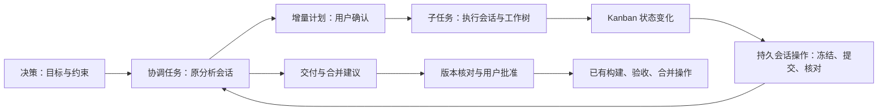

# 决策、协调任务与原会话操作

决策保存目标和已确认约束。重新运行前可以在停止并结算旧执行后更新原决策；保留其 ID、旧运行快照与审计事件，新一轮从更新后的正文开始。

任务仍只有一个父子模型：`execution: direct` 的叶子任务执行工作；`execution: children` 的任务组汇总子任务，设置 `coordination: true` 时保留原分析会话承担协调。无需额外的“分析 Agent 常驻进程”。子任务是否完成以交付核验和验收为准，模型退出不能代替完成。

## 统一会话操作

开发续办、Fix 和协调事件共用原会话定位与正式提交入口。定位原调用、逻辑 Session、分支和原生 binding；拒绝忙碌、失效或身份不明确的会话。后续轮次使用新 operationId，在原工作目录创建独立不可变 scope，不创建额外 worktree。请求冻结后跨重启只核对原回执，只有确定未接纳才能重试。

Fix 是原执行会话的新协作轮次。任务组的 Fix 使用原分析会话；不重开旧开发任务。关闭 Fix 操作后，普通会话输入继续可用。取消只控制该操作的正式 submission，不取消整个共享 Session。

## 事件与增量计划

Kanban 在已有扫描链中比较子任务状态指纹，不让模型轮询。无变化不发新 prompt，正常等待、准备和运行之间的变化不唤醒模型；初次仅有正常等待任务时建立基线；阻塞、澄清、待验收、完成及其解除触发协调。原会话忙碌时保留待处理状态，多个变化合并到下一次快照。在途操作继续核对，暂停只停止新协调准入。操作数据仍在既有 SeqFile journal，界面状态由其投影。

协调会话只分析跨任务问题和交付步骤，输出结构化建议。建议通过已有子任务操作入口执行；构建、替换、验收、合并的权限和版本确认保持有效。不会凭模型建议直接合入主目录或清理工作树。合并本身仍沿用原有具备对应工作树授权的执行机制，协调会话保持总览。

人工补充需求时，通过组的 Fix 进入原分析会话。模型发布 `kanban.coordination-proposal/1`，用户精确确认“完成”后，宿主校验局部 key、依赖图、单项目继承、估算和子任务类型，同事务发布新计划。`mode: append` 只允许新任务 ID，不修改已有任务、派发和计划。已完成任务组可以因增量计划重新进入汇总，原子任务完成记录不变。

自动协调结果为 `kanban.coordination/1`，包含 `ready: true`、summary 和 suggestions。建议仅引用当前快照内的子任务及已支持操作；界面提供子任务操作入口。真实澄清仍通过原会话和 MCP 解决，自动轮次不能批准新增工作或合并。

## 清理与重跑

取消、删除前同时核对开发、规划、Fix、协调及交付操作。停止旧轮次后保留会话历史与未合入工作树证据，不因重新运行删除未核验代码。原始决策的已确认产品结论与技术故障澄清分开：前者写回决策，后者修复默认策略，避免在下一轮重复询问。

## 构建与替换

构建表单可单独选择“构建成功后自动替换”，说明允许短暂中断；默认不勾选。确认意图与构建请求同一持久记录冻结。构建完成后，宿主以稳定的后续操作 ID 冻结替换请求，绑定该构建结果及源/目标版本。重启只核对原后续请求，不重复提交；版本变化则保留构建结果，报告需要重新构建。自动替换失败后显示单独重试入口，成功构建的按钮显示“重新构建”。查询不发起操作，扫描器负责续办。

原生 harness 常驻进程持有会话写锁不能直接证明工作树正在修改。清理仍严格拒绝该锁；原会话续办仅在授权 binding、原调用与执行树已结束、原生观察在线且未过期、确认 owned/idle、没有消息队列、草稿、待响应或未确认控制时允许继续。当前操作自身不计为另一项占用，其余操作仍阻止并发。

Session 发现项目构建/部署方式并准备脚本、参数和操作 manifest；通过已有且获授权的 Cells/项目执行能力运行。策略放在全局/项目可覆盖并按操作冻结的 `operation.md`。执行器必须独立于被替换的旧 httpd；能力不足时返回 blocked，禁止裸后台进程、权限升级或新增专用 NestOS reboot 接口。

构建/替换的原子终态回执位于该 scope 的 `result.json`，与 MCP result 使用同一 payload。宿主有界读取并冻结其摘要，冲突或改写拒绝；先核对操作身份、源/目标版本，再验证构建产物证据或实际运行版本。新 httpd 即使丢失原提交观察，也只能凭完整回执和匹配的运行版本恢复替换成功。回执和 MCP 通知本身不能证明成功。Cells/执行器也退出时保持未知并核对真实状态，不重跑结果未知的脚本；本机制不假定所有 Cells 执行端已具备跨进程退出的脚本恢复能力。

## 决策自动完成与受控部署

决策可显式选择 `completion: automatic`，界面显示全流程授权标志；默认 manual。授权随决策快照冻结，活动运行不能静默升级权限。自动流程依次执行构建、替换服务、验收、合入分析、无冲突合入、归档会话与清理工作树。每步保存固定 operationId 和回执，unknown 只观察不重发；错误、澄清、新冲突停下并通知。依赖放行和决策完成还须等待合入及资源清理，任务组汇总子任务后仅清理协调资源，不重复构建。

项目根 `_nestos/etc/deployment.json` 可声明 `{ "schema": 1, "serviceId": "httpd-..." }`。此声明选择目标，不授予权限；只有与管理员宿主注入的受信服务控制端口匹配，才使用持久启动器切换版本。模型只提交产物版本，不能取得宿主令牌或执行任意启动命令。其他项目继续用自己的 Session/Tool 部署机制，不根据名称、路径推断自身项目。

控制器在旧 httpd 退出前持久化切换意图，启动器停止旧进程、启动候选、检查真实版本后写回执；新 httpd 恢复原操作并验证源码快照。构建仍由原执行会话完成，合入仍由原会话分析并提交 task 关联信息。清理前归档相关会话，核对任务终态、Git 合入和干净状态；无法确认时保留资源。已清理的工作树不能原路径续办，须新任务或重新分配工作区。

合入分析发现冲突时，自动链记录 `OPERATION_SELECTION_REQUIRED` 并等待用户明确选择；此时不执行合入或清理。用户在原会话讨论并通过界面确认合入，标准合入操作核验成功后，自动链记录该人工操作 ID 并恢复清理。讨论结束、消息回执或选择已提交均不等于合入成功。

验收入口按正式派发 ID 查找工作树记录并校验项目、看板和任务上下文，不依赖卡片上的重复展示引用。操作回执使用相对原生 cwd 的路径；构建证据可存入 `_nestos/kanban/artifacts`，随协议归档，发布制品仍保存在独立的持久制品仓库。失败后用户确认的重建等操作核验成功，自动链可采纳其操作 ID 后继续，不能重发失败的旧请求。

Git 对含子模块的 worktree 要求 `remove --force`。平台仅在所有已初始化模块属于冻结授权范围、各自提交已合入对应主仓库、无修改和未归档忽略文件、会话归档且任务终态时允许这一参数；删除前再次核对同一版本。任何模块缺失、脏文件、未合入或未知状态均保留。普通 worktree 继续无 force 删除。

受信服务控制端口还可描述目标的制品格式、清单文件和基于项目源检出的持久发布位置；匹配项目声明后，这些非敏感要求随 build 上下文冻结并传给原会话。构建库包不等于构建可替换服务。控制器在任何停止副作用前验证实际制品；格式或文件不合格返回确定的未启动错误，允许用户确认重建后续办。

自动收尾按注入的目标身份串行，同一远程项目只允许一个事项进行构建、替换、验收、合入和清理，独立开发仍可并行。目标所有权存入同一个运行日志的短事务记录，跨重启保留，不占用长时间文件锁。后续事项显示等待同项目发布；已完成或确认取消且无未结算操作的所有者才释放目标。
