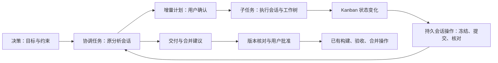

# 决策、协调任务与原会话操作

决策保存目标和已确认约束。重新运行前可以在停止并结算旧执行后更新原决策；保留其 ID、旧运行快照与审计事件，新一轮从更新后的正文开始。

任务采用同一父子模型并区分语义类型：`taskType: coordination` 就是任务组，负责澄清、拆分、汇总和原规划会话续办；`taskType: execution` 是实际工作的执行子任务。可定制的 `planning.kind`/rank 独立于语义类型，`execution: children` 保持组的调度汇总方式。决策按项目创建协调任务；同一项目默认只创建一个协调任务，仅独立目标或交付周期需要协调隔离时才增加。每个协调任务至少创建一个执行子任务，不派发父任务，不为多项目决策再套额外任务组。协调任务详情在分页前将未完成的执行任务排在上方，已完成和已取消任务排在下方。两组分别按编号数值升序排列，历史无编号任务置于组内末尾。

规划池按编号数值升序显示卡片。规划池协调任务的预览最多显示六个未完成的执行任务，按编号升序排列。筛选优先保留匹配的任务，完整列表沿用协调任务详情入口。

编号显示为 `KBD-<看板编号>-<决策编号>`、`KBC-<看板编号>-<事项编号>`、`KBT-<看板编号>-<事项编号>`，日志为 KBL。事项编号仍使用看板内单调计数，语义前缀不改变底层 ID；解析器同时可定位已经保留的历史引用。

执行子任务不能独立归档或删除；通过协调任务统一清理完整子树。清理前列出所含任务，确认停止状态，保留会话、工作区关联和完成证据。依赖关系不会触发级联清理；仍被组外未完成事项依赖时拒绝删除。失败任务的归档不等于成功，后置任务保持阻塞，由原管理会话通过已有 repair 机制安排修复。没有引入删除后自动补洞、伪造完成或重写历史计划的机制。

详情保留完整正文，用 mdxeditor 的只读渲染器展示工作内容和验收条件，默认预览十行，溢出时才显示展开按钮。验收与发布的固定说明放在问号帮助入口；实际交付操作独立呈现。评论使用既有 message 事件，只在用户打开时读取有界最新事件页，并可加载更早记录；关联讨论会话与低频表单收纳到技术详情。



正式调整经原决策会话确认后，宿主在保存决策和任务修订的同一事务中为每个受影响的任务追加备注。备注保留变更摘要、决策修订和确认来源，可由任务的评论区追溯。

## 决策阶段的 Harness

「提出决策」可分别选择创建决策、协调任务和执行任务的 Harness。每阶段可沿用看板默认。选择 Harness 后按目标工作区读取可用模型和推理级别，显式设置随阶段选择持久化。选择「默认不运行」后，确认会保存决策，用户可在详情中手动启动。创建选择在启动讨论时绑定，协调和执行的显式选择随正式决策保存，并进入每次运行和循环轮次的快照。没有阶段选择的历史决策继续使用看板默认。一次操作冻结选择后，刷新、重试和续办保留原绑定。

宿主在目标工作区核对项目登记、授权和 Harness 能力。显式配置被删除、未绑定目标工作区或权限与能力不足时，相关界面显示具体原因。已确认在会话创建前失败的操作可从原入口重新选择。宿主核对当前版本和新选择的授权，保留旧派发及回执。已经绑定会话的续办继续定位原会话。

## 统一会话操作

开发续办、Fix 和协调事件共用原会话定位与正式提交入口。定位原调用、逻辑 Session、分支和原生 binding；拒绝忙碌、失效或身份不明确的会话。后续轮次使用新 operationId，在原工作目录创建独立不可变 scope，不创建额外 worktree。请求冻结后跨重启只核对原回执，只有确定未接纳才能重试。

Fix 是原执行会话的新协作轮次。任务组的 Fix 使用原分析会话；不重开旧开发任务。关闭 Fix 操作后，普通会话输入继续可用。取消只控制该操作的正式 submission，不取消整个共享 Session。

看板查询、会话链接解析以及 `session_request` 请求／回执本身不创建 Session。管理任务的规划、后续协调和修复复用原管理会话；原执行的后续分析、构建与交付按原绑定续办。首次决策和独立执行仍保留各自身份与调用回执。正式执行先完成目标绑定和上下文准备，再创建稳定的调用方 Session；目标或依赖读取失败不遗留空会话。

配置明确声明的终态收尾提示词可能启动独立调用，保留调用方与实际执行子 Session，避免向已经停止的原任务发送新轮次；没有相应提示词时不创建收尾会话。此类临时收尾在调用方和执行树真实结算、结果通知持久化后，通过已有原生归档端口自动归档实际执行子 Session，并保存归档检查点。归档不删除历史，不归档原管理或原任务执行会话。后台恢复扫描也处理已结算但尚未归档的旧收尾记录；运行中、结果未知或身份变化时保留会话，归档失败只按稳定 operationId 核对原归档回执，不重派模型调用。失败后的再次检查时间随原收尾记录持久化：一般失败至少间隔一分钟，项目不可用或身份变化至少间隔五分钟，重启不绕过等待。调用方的本地执行账本继续保留用于审计，不凭标题批量处理普通会话。

## 事件与增量计划

Kanban 在已有扫描链中比较子任务状态指纹，不让模型轮询。无变化不发新 prompt，正常等待、准备和运行之间的变化不唤醒模型；初次仅有正常等待任务时建立基线；阻塞、澄清、待验收、完成及其解除触发协调。原会话忙碌时保留待处理状态，多个变化合并到下一次快照。在途操作继续核对，暂停只停止新协调准入。操作数据仍在既有 SeqFile journal，界面状态由其投影。

管理会话只分析跨任务问题和交付步骤，输出结构化建议。建议通过已有子任务操作入口执行；构建、替换、验收、合并的权限和版本确认保持有效。不会凭模型建议直接合入主目录或清理工作树。合并本身仍沿用原有具备对应工作树授权的执行机制，管理会话保持总览。

人工补充需求时，通过组的 Fix 进入原分析会话。模型发布 `kanban.coordination-proposal/1`，用户精确确认“完成”后，宿主校验局部 key、依赖图、单项目继承、估算和子任务类型，同事务发布新计划。`mode: append` 只允许新任务 ID，不修改已有任务、派发和计划。已完成任务组可以因增量计划重新进入汇总，原子任务完成记录不变。

自动协调结果为 `kanban.coordination/1`，包含 `ready: true`、summary 和 suggestions。建议仅引用当前快照内的子任务及已支持操作；界面提供子任务操作入口。真实澄清仍通过原会话和 MCP 解决，自动轮次不能批准新增工作或合并。

## 清理与重跑

取消、删除前同时核对开发、规划、Fix、协调及交付操作。停止旧轮次后保留会话历史与未合入工作树证据，不因重新运行删除未核验代码。原始决策的已确认产品结论与技术故障澄清分开：前者写回决策，后者修复默认策略，避免在下一轮重复询问。

## 构建与替换

构建表单可单独选择“构建成功后自动替换”，说明允许短暂中断；默认不勾选。确认意图与构建请求同一持久记录冻结。构建完成后，宿主以稳定的后续操作 ID 冻结替换请求，绑定该构建结果及源/目标版本。重启只核对原后续请求，不重复提交；版本变化则保留构建结果，报告需要重新构建。自动替换失败后显示单独重试入口，成功构建的按钮显示“重新构建”。查询不发起操作，扫描器负责续办。

原生 harness 常驻进程持有会话写锁不能直接证明工作树正在修改。清理仍严格拒绝该锁；原会话续办仅在授权 binding、原调用与执行树已结束、原生观察在线且未过期、确认 owned/idle、没有消息队列、草稿、待响应或未确认控制时允许继续。当前操作自身不计为另一项占用，其余操作仍阻止并发。

Session 发现项目构建/部署方式并准备脚本、参数和操作 manifest；通过已有且获授权的 Cells/项目执行能力运行。策略放在全局/项目可覆盖并按操作冻结的 `operation.md`。执行器必须独立于被替换的旧 httpd；能力不足时返回 blocked，禁止裸后台进程、权限升级或新增专用 NestOS reboot 接口。

构建/替换的原子终态回执位于该 scope 的 `result.json`，与 MCP result 使用同一 payload。宿主有界读取并冻结其摘要，冲突或改写拒绝；先核对操作身份、源/目标版本，再验证构建产物证据或实际运行版本。新 httpd 即使丢失原提交观察，也只能凭完整回执和匹配的运行版本恢复替换成功。回执和 MCP 通知本身不能证明成功。Cells/执行器也退出时保持未知并核对真实状态，不重跑结果未知的脚本；本机制不假定所有 Cells 执行端已具备跨进程退出的脚本恢复能力。

## 决策自动完成与受控部署

决策可显式选择 `completion: automatic`，界面显示全流程授权标志；默认 manual。授权随决策快照冻结，活动运行不能静默升级权限。自动流程依次执行构建、替换服务、验收、合入分析、无冲突合入、归档会话与清理工作树。每步保存固定 operationId 和回执，unknown 只观察不重发；错误、澄清、新冲突停下并通知。依赖放行和决策完成还须等待合入及资源清理，任务组汇总子任务后仅清理协调资源，不重复构建。

项目根 `_nestos/etc/deployment.json` 可声明 `{ "schema": 1, "serviceId": "httpd-..." }`。此声明选择目标，不授予权限；只有与管理员宿主注入的受信服务控制端口匹配，才使用持久启动器切换版本。模型只提交产物版本，不能取得宿主令牌或执行任意启动命令。其他项目继续用自己的 Session/Tool 部署机制，不根据名称、路径推断自身项目。

控制器在旧 httpd 退出前持久化切换意图，启动器停止旧进程、启动候选、检查真实版本后写回执；新 httpd 恢复原操作并验证源码快照。构建仍由原执行会话完成。原会话提供合入分析和任务关联，宿主对已授权且无冲突的普通仓库合入优先使用 Git 交付模块。模块在写入前分别核对合入、索引和工作目录三层，保护未跟踪及忽略文件，按原 operationId 原子登记目标分支和结果回执。会话处理内容冲突、子模块变更等需要继续核对的情形；写入结果未知时保留 Git 检查点，只核对原操作。清理前归档相关会话，核对任务终态、Git 合入和干净状态；无法确认时保留资源。已清理的工作树不能原路径续办，须新任务或重新分配工作区。

合入分析发现冲突时，自动链记录 `OPERATION_SELECTION_REQUIRED` 并等待用户明确选择；此时不执行合入或清理。用户在原会话讨论并通过界面确认合入，标准合入操作核验成功后，自动链记录该人工操作 ID 并恢复清理。讨论结束、消息回执或选择已提交均不等于合入成功。

验收入口按正式派发 ID 查找工作树记录并校验项目、看板和任务上下文，不依赖卡片上的重复展示引用。操作回执使用相对原生 cwd 的路径；构建证据可存入 `_nestos/kanban/artifacts`，随协议归档，发布制品仍保存在独立的持久制品仓库。失败后用户确认的重建等操作核验成功，自动链可采纳其操作 ID 后继续，不能重发失败的旧请求。

Git 对含子模块的 worktree 要求 `remove --force`。平台仅在所有已初始化模块属于冻结授权范围、各自提交已合入对应主仓库、无修改和未归档忽略文件、会话归档且任务终态时允许这一参数；删除前再次核对同一版本。任何模块缺失、脏文件、未合入或未知状态均保留。普通 worktree 继续无 force 删除。

受信服务控制端口还可描述目标的制品格式、清单文件和基于项目源检出的持久发布位置；匹配项目声明后，这些非敏感要求随 build 上下文冻结并传给原会话。构建库包不等于构建可替换服务。控制器在任何停止副作用前验证实际制品；格式或文件不合格返回确定的未启动错误，允许用户确认重建后续办。

自动收尾按注入的目标身份串行，同一远程项目只允许一个事项进行构建、替换、验收、合入和清理，独立开发仍可并行。目标所有权存入同一个运行日志的短事务记录，跨重启保留，不占用长时间文件锁。后续事项显示等待同项目发布；已完成或确认取消且无未结算操作的所有者才释放目标。

## Worktree 目录与收尾

看板的 Worktree 栏目分页列出已登记的资源、所属执行任务、协调任务及当前进度。`boardWorkResources` 先读小型关联索引及任务摘要，不读取规划正文、逐个检查 Git 或启动 Session。打开、刷新和分页只读元数据；用户点击单项“检查”才调用已有资源检查器。清理复用原 `cleanupWorkResource`，携带真实资源 owner、检查版本和稳定 operationId，并在副作用前复核，不能用任务完成状态替代合入与占用证据。

宿主在准备资源前登记 `work-resource:[boardId,resourceId]`，这是可从冻结 workspace 记录重建的读模型；清理状态仍以原 `worktree-cleanup` 回执为准。旧数据首次查看时有界遍历 workspace 记录补索引，后续不再扫描历史正文。关联索引不参与所有权授权，删除仍核对冻结上下文、项目、任务及实际 Git 状态。

任务若确需临时分支，先在分配目录的 `_nestos/kanban/managed-resources.json` 中登记：

```json
{"schema":"nestos.managed-resources/1","scopeId":"执行ID","branches":[{"repository":".","name":"verify/执行ID/check"}]}
```

repository 只能为项目根或本次已授权的模块路径，分支名只能为 `backup|back|verify|fix/<执行ID>/<名称>`。检查时核对每个分支是否已合入当前主检出、是否仍被任何 worktree 检出，并将其 HEAD 纳入确认版本。资源收尾先归档登记及协议证据，再复验并删除已登记的安全临时分支、worktree 与工作分支；未合入、使用中或范围不符时保留。任务组完成时，它及已交付子任务的正常资源收尾共同覆盖该组资源。未登记的历史临时分支由管理员单独盘点，不根据名称前缀自动认领或删除。

管理任务的分解与后续调度属于同一管理会话（内部 planning API 保持兼容），不是第三类规划会话。准备顺序为宿主 Git 模块建立工作区、发布上下文，再提交管理会话首轮；不得在此之前自动启动记录级沟通会话，抢占同一节点的执行资源。决策讨论与管理任务分别持有身份，创建 worktree 不需要 LLM。现有记录级会话保留用于显式沟通和历史追溯，不因开始管理任务而自动创建或发送 bootstrap。准入明确未提交的 EBUSY 使用既有恢复策略续办；结果未知只核对原操作，创建 worktree 的领取仅在正式未提交证据下撤回，未知创建仍核对原目录。


## 决策状态与下游进展

决策保留三类独立事实，不新增持久状态机：`record.status` 表示决策效力，`progress` 表示当前执行范围的汇总，Session 只提供协作入口与显式待处理问题。已确认且已开始执行的决策，不因原决策会话仍为 clarifying、空闲或结束而回到“需求讨论”。列表显示决策效力、总体进展、执行任务完成数及参与会话；不重复列出随执行任务汇总的管理任务状态。全部执行任务处于同一正常阶段时省略阶段计数，混合阶段和等待输入、异常、核对、暂停等状态仍具体展示。尚未分解执行任务时显示当前真实阶段，不显示 0/0。历史会话状态不作为执行阶段。

- `recordProgress` 在看板模块按当前关联管理任务及全部后代投影，统一复用任务阶段。未知优先显示核对中，错误或取消的执行任务阻塞所属未完成组，澄清和验收显示待处理；同时保留具体任务、原因及会话。已正式结算组的旧后代问题不推翻其结算事实。
- 管理与执行分别计数，父组的汇总不再当作执行任务重复计数；阶段计数保留 unknown、error、review、pausing 等原始差别。跨看板当前执行通过批量根摘要及其中后代计数读取，不逐条打开会话或追加读取全部执行正文；缺失根任务继续显示待核对。
- 管理/执行任务完成不等于决策已经交付完毕。发布或验收等交付步骤仍在进行时显示执行中，等待确认或处理显示待处理，收尾读取失败显示核对中。交付已完成且仅剩清理时，状态显示已完成，并在同一行展示清理进度、阻塞原因和操作入口。未结算的清理继续阻止归档及下游准入。此投影不修改已完成任务、原决策状态或任何执行回执，显式豁免保留标记。
- 决策讨论草稿仍显示讨论、待确认及实际阻塞，主要入口为决策会话。确认后，`progress.participation` 从同一范围的任务投影推荐参与入口：先处理异常并遵循 self/parent 责任归属，再选择已绑定会话的活动执行任务，最后回到管理任务。多个候选由用户选择；正式结算的管理任务不受旧后代状态影响。原决策会话保留在决策详情的“来源与上下文”，列表不重复展示历史入口。渲染和刷新不读取或创建 Session，点击才读取选中任务已有的真实绑定；无绑定时说明原因，不创建替代会话。

契约是可选字段增量扩展，旧 DTO 缺少任务计数时继续展示已有阶段。统计与状态由领域模块产生，UI 不从聊天内容、Session 活跃度或按钮是否存在推算完成。读取沿原批量摘要链路；活动时间只取持久业务事件，不使用刷新时间。

列表分别提供参与会话和管理任务入口：前者让用户参与当前需要处理的工作，后者查看整体任务状态。多个参与会话按真实任务名称展开选择；多个管理任务通过带数量的决策详情入口选择，详情保留全部真实绑定。需要处理、失败或核对中的行继续就近保留受影响任务、具体原因及对应会话入口，不因精简统计而移除恢复操作。任务计数仍分别保留在领域 DTO 中，UI 精简不改写状态或增加读取。

决策列表默认显示未归档记录，可切换已归档范围。多选只允许已结束并完成必要收尾的决策；运行或无法核对时禁用选择，并由后端再次检查。归档只隐藏决策，不停止执行、不归档会话和任务、不清理工作区；按 ID 和显式包含归档的 MCP 查询继续保留完整追溯。批量归档共享一次请求，逐项回执和稳定操作身份沿既有 journal 保留。

管理会话保持同一原生 Session 身份和工作目录，规划、协调及交付是不同阶段。阶段切换可以更换内部通道 scope，宿主读取并核对当前通道与原 Session 的绑定后迁移订阅，不继续监听旧规划通道，也不创建替代会话。观察端按绑定的 watchKey 更新订阅；原生会话空闲事件用于发现后续通道变更。请求回执按实际通道 scope 持久化和续办，逻辑管理会话身份保持不变。

管理入口统一通过管理任务的 planningSession 解析原生绑定并登记通道观察。决策级 openRecordCoordination 不创建额外 Session；多个管理任务要求从具体任务进入，尚未产生原生绑定时返回 MANAGEMENT_SESSION_NOT_READY。读取失败不能转成创建替代会话。

项目 deployment.json 的 schema 2 支持 defaultServiceId 与按管理任务 ID 的 bindings；schema 1 继续兼容。可信宿主通过 NESTOS_SERVICE_MODULES 或管理员私有 ~/.config/nestos/service-modules.json 加载独立 RuntimeServiceControl 模块（条目含 id、绝对 module 路径与私有 options），项目只能选择已登记目标，不能提供控制器代码。构建冻结目标描述和命令，核验后的回执带 deployment.serviceId，部署前改绑会要求重建。部署和验收读取任务目标的真实运行版本，不使用看板宿主版本代替。Cells 具体构建、Firecracker 切换与进程哈希核验在 tools/cells-deployment 外部插件；核心不按组件名分支。失败摘要就近显示，不仅藏在悬停说明中。

软件交付清理只处置执行资源。当前管理任务的规划目录已承载持续管理会话，软件插件的宿主资源端口将其标为 WORKTREE_MANAGEMENT_SESSION_RETAINED，自动清理跳过该资源；管理会话显式归档/移除关联后才按原归属、空闲、Git 及回执检查处置。历史版本已删除 Git 工作树时，只对已验证的 retainedPlanning 绑定与 cleaned 回执恢复原路径的会话目录锚点；会话上下文仍取 Cells 的持久通道快照，不创建新 Session、不恢复 Git 工作树、不改会话 ID 或目录路径。

自动收尾同样不归档持续管理会话：按原规划执行绑定及真实 Native 资源链接识别其所有 Core Session 别名，只归档执行会话；用户显式归档入口保持原授权与回执链。

机械清理未通过时，软件交付插件先把清理保持为处理中，并以稳定请求身份将冻结的合入回执、执行资源及保护目录交给原管理会话。管理会话检查实际暂存、未跟踪、子仓库和占用情况，只准备本任务已交付资源的清理；独有改动必须保留。完成尝试后通过按需发现的 `delivery.cleanup.complete` 请求宿主重新检查并执行正式资源移除。只有宿主回执确认资源清理才完成；尝试后仍有残留才记录具体阻塞原因。队列回执丢失继续核对原身份，不创建另一管理会话。历史明确保留的资源不会被自动重新清理，用户要求时通过 `delivery.cleanup.start` 选择资源重新开始；`cleanup.read` 读取冻结范围和当前状态。管理会话及其目录继续保留，不属于软件交付的临时执行资源。

执行中的专项检查可由用户明确豁免。管理会话通过按需发现的 `delivery.verification.preview` 冻结具体检查、原因、原任务 revision 及当前 dispatch；`verification.waive` 核对原生用户确认后调用通用 `waive-execution-checks` 命令。持久记录包含原验收正文、豁免项、原因、用户、时间与原执行身份；不改变 sealed 计划，不解决原错误，不制造执行成功。原执行会话收到同一稳定队列通知，按原完成协议提交实现结果；后续构建、替换、验收和清理继续取得独立宿主回执。丢失通知回执时沿原身份核对，不重复领域提交。任务完成后显示部分豁免，并在详情保留未验证项；后续实测记录不能回写为此前已验证。

`changes` 源仓库和子仓库的 HEAD 必须始终保持冻结基线；整合提交只能生成于目标仓库，不能先提交源工作树再 cherry-pick。目标保留独立改动时，合入核验以冻结源基线、源文件和冻结目标提交计算 Git 三方合并 blob，要求与实际目标 blob 完全一致；不再把合法保留的目标改动误判成源文件未合入。核验不移动 HEAD、分支或索引；冲突、缺失源效果或额外未授权编辑继续拒绝，缺少 Git object-id 合并能力时明确阻塞。失败日志记录关联 operationId、仓库、路径摘要、源/目标 blob 和耗时，不记录文件正文。

## 决策自动化模块与执行审批

新建决策时，项目选择下方列出宿主提供的自动化模块，初始均未勾选。创建讨论会话时冻结模块及版本。建议预览和正式决策使用这份选择，模型无法修改。决策详情展示已选模块。旧决策没有模块记录时继续使用人工审批。

执行会话将原生审批交互登记在独立调用里。Kanban 的扫描复用原调用视图，把待审批交互交给该决策所选的同版本模块。以软件开发模块为例，只有宿主允许清单里的项目、原生配置和完整命令匹配，且当前请求属于原任务的原生会话、活动轮次及工作目录时，才回复一次 `accept`。带额外权限的请求、无法定位的请求、暂停或已变更的任务保留原有处理入口。安装失败、文件系统报错、连接授权失败和资源占用继续显示原诊断。

回复沿用人工审批的 Session API。宿主按原调用、目标 Task 和交互记录冻结操作 ID，提交前只占用该操作的 journal 条目。结果未知时核对原回执，执行会话继续负责真正的命令结果。其他可信模块可以通过 `ApplicationRuntimeOptions.kanbanApprovalModules` 声明标识、版本、显示名称和判断函数，复用决策选择、权限范围校验及回复机制。

Node 宿主通过部署环境变量 `NESTOS_KANBAN_MODULE_PERMISSIONS` 读取规则。管理员宿主配置示例：

```json
{
  "software-development": {
    "allow": [
      { "projectId": "local-example", "profileId": "codex", "command": "git status --short" }
    ]
  }
}
```

缺少规则时，请求留在原执行会话等待人工处理。项目仓库、Prompt 和模型消息无权修改允许清单。更改环境配置后由宿主重新装载，审批时按当前规则核对。

## 规划重试

提交时禁用当前操作，收到宿主接纳回执后显示「重试中」。等待超过 30 秒时提供只读的「刷新状态」。看板收到新的失败状态后恢复重试。遇到另一个窗口已受理的竞态时，先读取当前规划状态，再更新操作和提示。

## 规则更新与重新运行

任务详情的“重新运行”先预览受影响任务并要求确认。宿主等待旧执行结算，再按新派发身份读取并冻结开发提示词和已发布的执行目标。原会话与工作树仍保留供核对。选择“继续”时沿用已有执行绑定和续办流程。当前没有在运行中展示 Prompt 或 MCP 变更、确认后切换快照的入口。

## 复查环境并继续

执行已结束且正式结果缺失时，任务详情按照含派发记录的状态显示“进入会话处理”，链接到原执行会话。可在那里核对当前工作、继续未完成步骤并提交正式结果。宿主沿原派发核对结果和交付证据。

选择软件开发模块的决策，可以在项目 `_nestos/etc/kanban/development/prerequisites.json` 声明前置条件。宿主把声明随初次派发冻结。以下示例同时检查 PATH 下的命令和工作树内的依赖标记。配置时按项目实际工具及安装布局填写。

```json
{
  "schema": 1,
  "executables": ["node", "npm", "pnpm"],
  "binDirectories": ["release/worktree-toolchain/bin"],
  "files": ["node_modules/.modules.yaml", "libraries/kanban/package.json"]
}
```

执行失败或原会话留下待处理的错误报告时，如果原工作树可以续用，任务恢复区显示“复查环境并继续”。点击后用已授权项目进程在原工作树内查找命令并检查文件。条件未齐时返回缺项，用户可以安装后再次点击。通过时提交原会话的续办请求。对仍挂在当前派发上的报告，沿用原派发，执行会话核对并给出关联的解决回执。原工作树、已有改动和失败证据继续保留。验收、发布和清理以各自回执为准。

在仅初始化选定子模块的工作树中，`pnpm docs:check` 可使用宿主本地 Git 对象，核对未初始化子模块在索引固定提交中的链接目标。成功输出单独记录通过此方式核对的目标数，活文档计数以当前检出的文件为准。对象或目标缺失时检查失败。

原执行会话用 `session_report` 上报具体缺项。获授权的恢复会话可用 `session_request` 的 `kanban.recovery.inspect` 读取当前状态和可用操作，再按返回的修订调用允许的操作。管理会话可通过 `kanban.discover`、`kanban.describe` 和 `kanban.invoke` 查询或申请软件交付操作。先读 `delivery.read` 确认可用动作，再通过 `delivery.run` 按当前作用域、修订和确认要求提交。项目工具链变更仍需项目或服务相应权限。

已确认的自动交付决策，若原生轮次结束、宿主已记录正式结果缺失且没有待处理的问题，可沿原会话和原工作树自动续办一次。续办操作使用稳定身份，宿主仍须核对正式回执。执行范围内尚未完成的步骤通过进展报告记录；需要管理方处理时须写明具体外部依赖和所需动作。

自动交付的已确认决策允许每次派发自动续办一次执行方自行处理的单个错误。如果未解决的问题都由执行方自行处理，最近的问题之后有新的结构化进展，宿主可按不同的已结束轮次和进展记录再续办，最多三次。宿主核对派发所有权、工作树和暂停状态，沿用原任务回复通道，并保留原阻塞直至原会话发布关联的解决回执。存在正式结果、需要管理方处理的错误或待澄清问题时，不触发这种续办。

## 受管项目自身升级与验收

开发任务、交付复核和决策协调 Harness 可通过已有 `session_request` 查询受管项目的服务诊断。先调用 `kanban.discover`，再用 `kanban.invoke` 请求 `{pluginId:"service-diagnostics",method:"read",input:{operationId:"…"}}`。也可使用 `requestId`，时间范围默认 30 分钟且最多 120 分钟，结果最多 50 条。收到 pending 时沿用原会话的续办协议。

诊断默认关闭。管理员在工作台打开已登记项目的菜单，选择「Harness 日志访问」，勾选 httpd 运行日志、Cells 服务日志或两者，再保存。全部取消即关闭。设置存放在 httpd 运行用户的私有目录 `~/.config/nestos/service-diagnostics/`，服务重启后保留。已登记项目的绑定授权与勾选来源在每次查询时核对，保存后随下一次查询生效。两个页面并发保存时，旧版本会收到冲突提示。侧栏进入项目后，「…」直接打开该项目菜单。

管理员可通过 `~/.config/nestos/service-diagnostic-projects.json`（0600）或 `NESTOS_SERVICE_DIAGNOSTIC_PROJECTS` 单独登记可配置日志的项目，记录字段沿用服务绑定结构。工作台菜单只显示在与诊断登记匹配的项目上。这份登记仅授予日志配置资格，服务部署继续使用 `service-projects.json` 或 `NESTOS_SERVICE_PROJECTS`。未设置诊断登记时，沿用原服务登记兼容旧配置。登记内的 `"diagnostics": true` 默认开放两个来源，缺省或 `false` 默认关闭。工作台已保存的来源列表覆盖该默认值。撤销诊断登记会阻止后续查询。httpd 路径由宿主的 `NESTOS_HTTPD_LOG_DIR` 选择，缺省为 `/var/log/nestos`。Cells 来源由宿主固定为本机的 Cells 服务日志。Cells TOML 与项目目录里的配置不授予访问权限。

诊断只在具有 httpd 控制器的管理员运行时提供。实际调用重新核对该会话绑定的项目及管理员登记的 httpd 项目授权。httpd 只返回可确认属于管理员且匹配项目的结构化记录；本机 Cells 只读取固定 systemd 单元里、与绑定节点身份吻合的进程日志。每条只返回时间、操作、阶段、结果、错误码和耗时，缺少可验证归属的记录不进入结果。Harness 文件系统无需挂载宿主日志目录，查询不改变版本、任务或会话状态。验证和发布仍走受管交付流程。

项目可在 _nestos/etc/deployment.json 选择 httpd（当前受管 HTTP 服务的稳定别名）或管理员注册的服务 ID，例如 cells-x1。管理员在 ~/.config/nestos/service-projects.json（0600）或 NESTOS_SERVICE_PROJECTS 声明允许的项目与服务对应关系。记录由 serviceId、serverId、serverProjectId、principalId、alias 和 root 组成。宿主取已挂载根授权，并向 Cells 核对同一项目 ID 的导出别名与目录。改节点、项目、授权主体、根目录或服务后，旧构建需要重做；已提交的操作继续按原操作 ID 核对回执。

仓库标识、Git 历史和项目声明可帮助发现升级候选。同一 Git 提交可出现在多个克隆中，操作准入还要核对管理员绑定。受管构建使用控制器提供的命令，在冻结的集成提交产生候选和清单摘要；宿主从自身制品库核对清单摘要及 Git commit。HTTP 托管构建要求干净源码。HTTP 使用 build --no-activate --receipt 构建，持久启动器执行版本切换，宿主重启后继续核对同一回执。Cells 项目绑定发布在注册目标上复用二进制与配置的校验、备份与进程核对。Cells 控制器从管理员 options.configSource 读取专用配置，未设置时使用目标现有配置。

对 HTTP 自身升级，可在相同的管理员绑定中增加 `sourceCheckout`，填写宿主启动器使用的源码检出绝对路径。宿主启动时核对规范路径并记录匹配结果，操作时再次核对路径和 Cells 绑定。同一份 Git 历史在不同的检出目录不会通过路径核对。已有未设置该字段的显式授权绑定继续有效。

宿主管理员可独立使用 `pnpm httpd:deploy` 和 `pnpm cells:redeploy [cells-x1|local]`。管理任务从看板发起构建时，若当前 HTTP 运行制品对应本次合入的确切提交，宿主核对制品清单、摘要及冻结范围后记入构建回执。随后从看板发起发布时，启动器核对目标仍为预期版本且健康，按本次操作 ID 持久记录成功，复用当前进程。目标不同则继续正常切换并等待回执。验收仍从目标读取真实运行版本。
