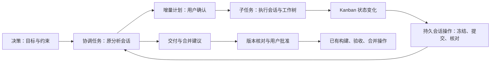

# 决策、协调任务与原会话操作

决策保存目标和已确认约束。重新运行前可以在停止并结算旧执行后更新原决策；保留其 ID、旧运行快照与审计事件，新一轮从更新后的正文开始。

任务仍只有一个父子模型：`execution: direct` 的叶子任务执行工作；`execution: children` 的任务组汇总子任务，设置 `coordination: true` 时保留原分析会话承担协调。无需额外的“分析 Agent 常驻进程”。子任务是否完成以交付核验和验收为准，模型退出不能代替完成。

## 统一会话操作

开发续办、Fix 和协调事件共用原会话定位与正式提交入口。定位原调用、逻辑 Session、分支和原生 binding；拒绝忙碌、失效或身份不明确的会话。后续轮次使用新 operationId，在原工作目录创建独立不可变 scope，不创建额外 worktree。请求冻结后跨重启只核对原回执，只有确定未接纳才能重试。

Fix 是原执行会话的新协作轮次。任务组的 Fix 使用原分析会话；不重开旧开发任务。关闭 Fix 操作后，普通会话输入继续可用。取消只控制该操作的正式 submission，不取消整个共享 Session。

## 事件与增量计划

Kanban 在已有扫描链中比较子任务状态指纹，不让模型轮询。无变化不发新 prompt，正常等待、准备和运行之间的变化不唤醒模型；初次仅有正常等待任务时建立基线；阻塞、澄清、待验收、完成及其解除触发协调。原会话忙碌时保留待处理状态，多个变化合并到下一次快照。在途操作继续核对，暂停只停止新协调准入。操作数据仍在既有 SeqFile journal，界面状态由其投影。

协调会话只分析跨任务问题和交付步骤，输出结构化建议。建议通过已有子任务操作入口执行；构建、替换、验收、合并的权限和版本确认保持有效。不会凭模型建议直接合入主目录或清理工作树。合并本身仍沿用原有具备对应工作树授权的执行机制，协调会话保持总览。

人工补充需求时，通过组的 Fix 进入原分析会话。模型发布 `kanban.coordination-proposal/1`，用户精确确认“完成”后，宿主校验局部 key、依赖图、单项目继承、估算和子任务类型，同事务发布新计划。`mode: append` 只允许新任务 ID，不修改已有任务、派发和计划。已完成任务组可以因增量计划重新进入汇总，原子任务完成记录不变。

自动协调结果为 `kanban.coordination/1`，包含 `ready: true`、summary 和 suggestions。建议仅引用当前快照内的子任务及已支持操作；界面提供子任务操作入口。真实澄清仍通过原会话和 MCP 解决，自动轮次不能批准新增工作或合并。

## 清理与重跑

取消、删除前同时核对开发、规划、Fix、协调及交付操作。停止旧轮次后保留会话历史与未合入工作树证据，不因重新运行删除未核验代码。原始决策的已确认产品结论与技术故障澄清分开：前者写回决策，后者修复默认策略，避免在下一轮重复询问。
