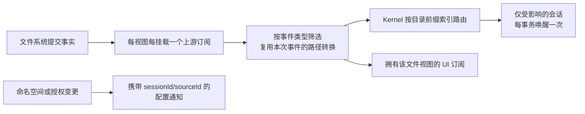
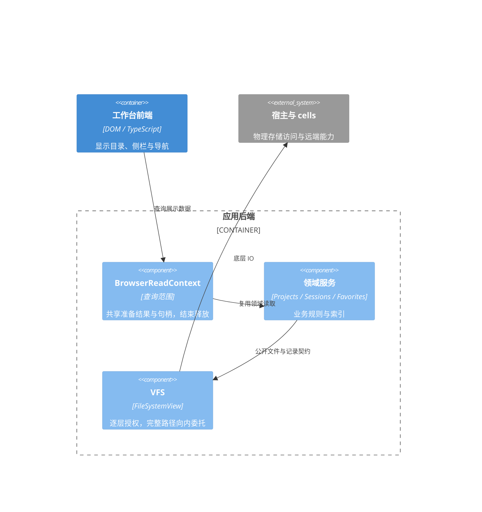

# VFS 读取性能与架构审查

2026-09-22。范围为启动、Session 打开及其经过的 VFS 读取链；不是整个 VFS 的全面正确性审计。

## 2026-11-04 更新

此前“所有读取复用写事务”的恢复边界已改为命名空间版本校验的只读快照：普通目录和记录读取使用 `BEGIN`，只有写入及发现遗留 rename intent 时使用 `BEGIN IMMEDIATE`。同连接保留事务归属队列，跨连接 WAL 读写可并行；前后版本变化时丢弃结果或读取错误并重读，避免重命名造成文件与 metadata 混合。SeqFile 批量读和路径映射使用同一个 `readTransaction` 端口，不维护旧的读转写事务路径。Node、Tauri、IndexedDB 及内存后端均已接入。

列表范围与索引见 [项目导航](project-session-navigation.md)。下文保留先前问题及性能基线，原事务计数不代表当前只读路径。

## 结论与本次改动

主要问题是调用者所需信息与读取粒度不匹配，以及单个业务读取被拆成多个存储事务。没有证据表明应替换 VFS 或 Tauri。保留现有协议、视图授权、后端实现分层，收紧读取职责即可取得明显收益。

- `DirectoryDriver.exists/resolvePath`、`FileSystemView.exists/resolvePath`、视图列表的父目录类型检查使用已有 `statType` 能力；不再为布尔值/类型加载 tags、icon、metadata。后端没有轻量能力时仍回退完整 stat。
- `DirectoryDriver.readContent` 的存在检查、`VFSEngine.readContent` 的目录类型检查同样不读取元数据。保留 SeqFile 内容投影、路径验证和即时文件存在检查。
- 轻量视图查询保留 synthetic 父目录：内层物理目录不存在，但该路径下有挂载时仍返回虚拟目录。
- SessionRepository 提供可选 `readHistoryChain`，在一次事务内校验 Session 身份、存储/历史版本，并读取当前 head 的主父链。无此能力的 repository 仍逐轮读取。父链遍历和坏文档容错抽取为共用函数，避免两条实现漂移。
- `getSessionSettings` 的校验与内容读取合并为一次事务。跨进程 journal 检查仍由每个外层事务执行；不使用永久存在性缓存。

## 可复现证据

隔离 LocalFS + SQLite 暖启动（无 Session、无 UI）：本轮事务 149 → 70，附加元数据读取 142 → 66，record 字段读取 158 → 79。普通文件读取仍为 27，目录枚举仍为 5，配置文件写入仍为 0。此前第一轮优化前事务为 221、元数据为 208。

100 轮历史、新建 SessionRegistry 加载：事务 101 → 1，record 字段读取 403 → 103，附加元数据和记录写入均为 0。仅读取所选分支主父链，不枚举整个历史库或挂载内容。

这些是存储逻辑调用次数，不是 Tauri IPC 总数；一种方法可能发出多条 IPC。`ioStats` 本身也只覆盖被引擎计量的操作，不能单凭 stat 计数推算实际磁盘操作数。

## 后续改进优先级（下方记录本轮实施状态）

| 优先级 | 发现 | 建议与边界 |
|---|---|---|
| 高 | `DirectoryDriver.getChildren({ fields: 'entry' })` 先读取完整 FSNode 后再裁剪；FileSystemView 也强制传 `fields: 'full'` | 为列表定义后端可选轻量条目端口，并贯通 engine、driver、view；需要大小/时间的条目与完整元数据分开。保留路径归属、隐藏目录和 nested mount 过滤，不能只修改返回类型 |
| 高 | `SeqFileOps.getEntries` 虽然使用 Promise.all，LocalFS 的每个 getRecordField 仍通过串行队列开独立事务 | 真正合并记录读取事务；再考虑宿主批量查询。不能靠增加并发数或跳过 journal 达成 |
| 高 | `DirectoryDriver.readContent` 对有 records 能力的后端先尝试 SeqFile 序列化，普通 JSON 文件也会探测记录；普通内容随后还会再检查类型 | 明确“普通字节文件”和“记录投影文件”的路由契约。LocalFS 两者目前都可能报告 type=file，不能仅凭类型或扩展名跳过记录，否则会改变已有 SeqFile 语义 |
| 高（正确性） | `VFSEngine.readContent` 捕获底层读取异常并返回空 buffer，`readBySystemPath` 返回空串 | 统一 ENOENT、权限、I/O 故障的错误契约，让调用者明确决定是否使用默认值；这是语义调整，应独立验证，不能混同于性能优化 |
| 中 | `EnginePort` 声称是最小端口，却直接依赖具体 VFSEngine；FileSystemView 的动态方法分派依赖较多 any | 收窄为实际使用的读写能力接口，并给动态参数/返回值建立类型映射；按调用点逐步替换，避免整体重写 |
| 中 | Session 的单次历史事务仍逐轮跨宿主查询；Tauri 使用 BEGIN IMMEDIATE | 长历史会延长事务持有时间。进一步优化应使用有界批量读取/明确的一致性快照方案；不要在历史事务内执行 Task 恢复、UI 渲染或外部回调。本次事务在历史取完后结束，再做恢复与投影 |

不应为了减少统计数字省略租约、挂载授权、链接拒绝、固定布局保护或恢复 intent 核对。也不应把 Session 可访问的挂载目录视为其拥有的目录。

## 本轮实施

上述四项高优先级已落地：

- 新增可选 `IStorageBackend.listEntries`，贯通 engine、DirectoryDriver、FileSystemView；LocalFS 共用分批 stat 的列表实现，轻量分支不访问 sidecar 元数据。无此端口的后端回退 list 并裁剪字段。视图保留路径归属、可读范围、隐藏项和挂载遮蔽检查；挂载边界补入的节点仍可能需要完整 stat。
- `SeqFileOps.getEntries` 将去重后的字段读取放进一次 records 事务，无事务能力的后端保留逐字段回退。现有节点校验另占一次事务；读取 N 个键不再产生 N 个独立记录事务，journal 恢复保留。
- `ReadOptions.representation` 明确 `auto`（兼容记录优先）、`bytes`（物理内容）、`records`（仅记录投影）。不是根据扩展名猜测。Provider/Connection、Agent 与普通 JSON 配置读取明确使用 bytes，跳过 SeqFile 探测和重复类型检查；同名 JSON 文件上的 records 在 auto 模式下仍可读取。
- 引擎读取失败传播 FSError，保留错误码和 cause，不再把权限、文件消失、I/O 错误转为空内容；真正的空文件仍正常返回空内容。内容转换只返回 Uint8Array 的有效区间，避免底层共享 buffer 的前后字节混入结果。

架构方面，能力层依赖的 `EnginePort.engine` 已收窄为独立 `CapabilityEngine` 接口，不再引用具体 VFSEngine；视图列表使用明确的 ListOptions/DirEntry 类型。其他动态方法分派仍存在 any，宿主多字段 SQL 批量端口也尚未加入：当前已合并事务，但不把“事务数下降”宣称为“所有字段只用一次 IPC”。

复测隔离暖启动：事务 **70 → 44**，元数据读取 **66 → 49**，record 列表探测 **35 → 9**；普通文件读取 27、目录枚举 5、配置写入 0 不变。65 条真实 LocalFS 文件经嵌套视图轻量列举时，元数据读取和 record 查询均为 0，链接仍不出现在列表。

Session 文件上下文的挂载根、cwd 检查使用类型端口；启动只恢复会话分组而不恢复 Session 子目录。侧栏刷新按真实展开状态决定读取范围，不能把残留 children 当成展开状态。详见 [Session 浏览契约](./vfs-session-browser.md)。

## 验证入口

- vfs-core：类型读取、虚拟父目录、删除后立即可见、路径逃逸拒绝，以及既有视图/SeqFile/挂载回归。
- vfsdriver-local：跨进程 rename journal、SIGKILL 恢复、链接与批量类型查询回归。
- llm-session：历史顺序、分支重载、空分支、环、缺失祖先、身份/版本检查和兼容后端。
- app-shell：真实 LocalFS 100 轮读取计数、Kernel + 编辑器初始化、设置/草稿不回写、审批恢复。

Session 界面渲染和分段日志见 [Session 性能审查](./llm-ui-session-performance.md)。

2026-09-22 录制分析后的补充：LocalFS 的 `statType` 在同一微批次内按路径复用 pending Promise，避免同一个祖先在宿主批量请求中重复出现；批次发出时即丢弃该表，下一批仍检查真实文件。删除和符号链接回归保持通过。Kernel 首次布局准备将固定文件的存在性检查并发合批，缺失文件仍顺序创建，避免失败后遗留在途创建。已有 Session 的 UI 绑定改用打开路径，进一步省去重复固定布局检查；没有加入挂载目录 TTL 缓存。

本轮验证通过：vfs-core 194 项、LocalFS 85 项（含跨进程崩溃恢复）、IndexedDB 15 项、llm-session 165 项、llm-ui 全包、vfs-ui 97 项、app-core 124 项、driver-llm 配置/Skill/MCP/提示词定向 14 项；app-shell 的 Session 加载/导航/审批恢复/历史渲染与 Flow 控件定向回归通过。9 个相关包/应用类型检查、Tauri 前端与 native dev 构建通过；文档检查保留原有 5 条历史符号告警。未对真实用户 profile 执行写入测试，也未完成真实桌面的优化前后计时对比。

后续 Session 切换轮次已将仓库展示读取合并为单次快照、Session 列表改为每批 64 个事务读取、挂载授权与 cwd 共用同一 revision 的配置，并消除重复 catalog 写入。审批恢复复用已有 Task 状态索引，跳过终态 Task 正文与目录枚举。没有新增通用 VFS TTL 缓存，也没有省略权限/恢复检查；宿主多字段 SQL 批量端口仍未实现。A → B → A 的测量方法、收益及剩余 DOM 热点见 [Session 性能审查](./llm-ui-session-performance.md)。

## 订阅分发与读取开销的边界

现场对旧 HTTP 宿主进行 5 秒 CPU 采样：约 46% 样本包含 `seq:committed → FileSystemView.eventPayload` 分发链，其中大量时间用于重复路径规范化；该证据解释 CPU 热点，但不能单独证明关闭流程具体阻塞在哪个 Promise。关闭阶段诊断另外记录 PID、operationId 和等待耗时。

优化采用分层职责，而非把所有事件复制到新的存储：

- FileSystemView 的 typed/onAny 共享上游租约，最后一个订阅者退出立即解绑；内容对象仍按回调独立，不能为性能把可变 payload 共享给不同消费者。事件类型不相关时不转换；同一路径每事件每挂载转换一次。
- Kernel 不再为每个 Session 单独监听全量提交，再遍历过滤。按 IFileSystem 共享监听，把变化路径沿祖先目录查索引，一次提交只通知匹配根目录的订阅者。复杂度与变化路径深度和实际命中数量相关，不与全部空闲 Session 数量相关；持久水位补扫保留，进程内路由不是恢复真相。
- DirectoryFS 的 typed 监听直接使用底层类型通道，dispose 释放自己拥有的订阅。
- SessionFiles 的配置通知只表达授权、命名空间或来源可用性变化，并携带作用域。普通内容和内部 seq 写入通过已取得的文件系统能力观察，不能再转成全局文件配置失效；一个 Session 的授权变更不会使其他 Session 的配置快照失效。
- Workbench 的宽事件监听只标记脏状态，目录刷新保留可见性和合并调度；不能仅因出现 onAny 就判定需要读取文件。对于具体查询的缓存，需按其数据依赖判断失效范围，不能把所有通知一律改成定时重读。

回归覆盖 100 个订阅者共享一次路径转换、回调数据独立、100 个 Session 仅唤醒对应根目录、最后一个订阅者释放上游，以及文件变化不广播为全局命名空间变更。

Kernel 本地提交已经经作用域路由唤醒对应会话，不应再触发一次全局水位扫描。CommitRescanner 保留跨进程遗漏补扫，但使用 getEntriesMany 的只读批量快照，不为纯读取建立写事务。自动化 Journal 对内容相同的更新不重复写入或广播提交；决策状态没有变化时不更新 updatedAt，避免检查本身制造变化。

## 工作台查询范围与嵌套视图校验（2026-11-04）

工作台展示准备由 app-core 的 `BrowserReadContext` 拥有：同一次目录查询共享项目目录、组织记录、收藏读取和工作区句柄。文件准备不依赖导航完成，避免慢导航阻塞已授权文件的显示。查询完成或失败均排空已接纳读取并释放借用句柄；下一次查询重新读取，不把该范围内的复用扩展为授权或跨进程数据缓存。项目根不再读取不会显示的完整本地 Session 摘要。

应用层 `readDirectoryView` 继续通过 VFS 读取投影目录；它等待目录与导航两条分支都结束后清理。前端刷新先取得聚合结果，目录种子供侧栏消费，项目导航和正文复用同一结果；不在前端重新组合领域记录。

VFS 每层保留自身路径规范化、可见性、挂载和写权限约束。来源是同一实现的 `FileSystemView` 时，外层把完整映射路径交给内层，不再逐前缀触发内层递归走查；未知来源继续完整前缀检查。该委托不缓存路径判定，符号链接、跨挂载和只读拒绝保持在各自边界。

确定性内存基准：五级路径、20 次读取，1/2/4/8 层额外视图，旧实现底层类型检查分别为 440/1140/5060/40060 次，新实现均为 140 次。8 层单轮耗时样本为 846ms → 5ms；这是机制验证，不是线上 x1 首屏延迟保证。

HTTP 物理前缀强化检查由 `http.strictPathChecks` 控制，默认关闭，范围与限制见 [HTTP 宿主](../http-app.md#存储路径强化检查)。

